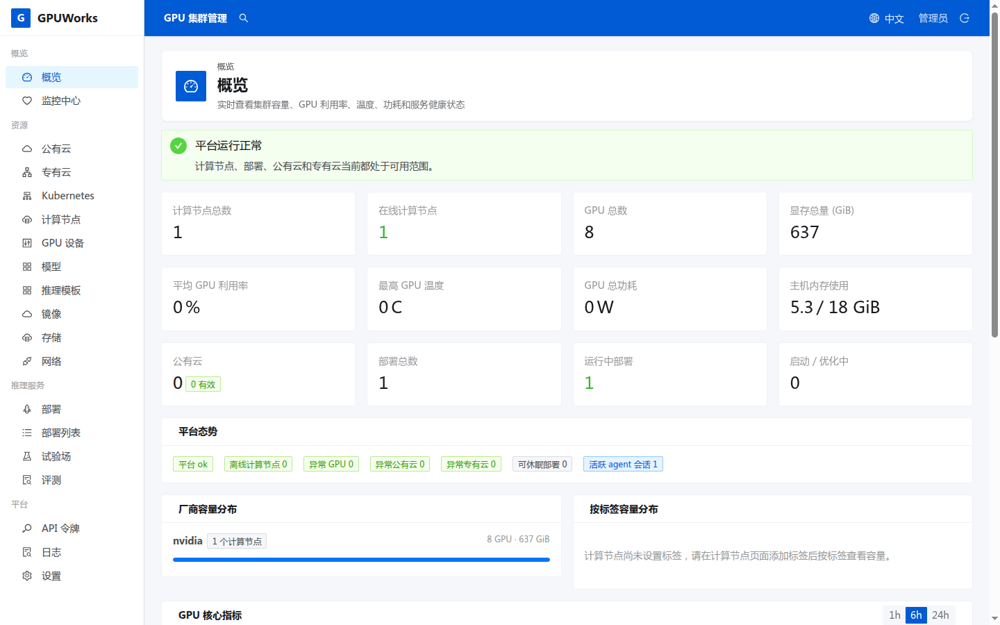

# GPUWorks

轻量易用的 GPU 集群管理平台：把一批 GPU 主机接进来，在网页上部署 vLLM / SGLang 推理服务，
通过 OpenAI 兼容网关对外提供调用。



## 它能做什么

- **节点接入**：一条 `curl | sh` 命令接入 GPU 节点，agent 主动外连，节点无需开放入站端口；出站受限的节点可改由 server 直连 agent 的监听端口（`server_dial`）。
- **GPU 探测与拓扑**：NVIDIA、昇腾、平头哥 PPU、海光；不依赖 NVML，不需要 cgo。
- **模型部署**：内置推理模板目录，部署前估算显存，由调度器选卡并解释选择理由；支持多副本、多机推理和 PD 分离。
- **dGPU**：给整张卡加显存（部分厂商含算力）配额，让多个实例共用一张卡；sleep/wake 让多个模型轮流使用同一张卡。
- **OpenAI 兼容网关**：`/v1/chat/completions`、embeddings、rerank、音频、图像等，带负载均衡与失败重试。
- **运维**：指标与日志检索、内置压测与评测报告、Web 终端、AI 助手。
- **云与离线**：接入 RunPod、优云智算（CompShare）、AutoDL、Vast.ai 账号，同步云主机并一键安装 agent；离线环境支持镜像包与 HTTP 文件服务器导入。
- **单文件部署**：server 与 agent 都是静态单二进制（`CGO_ENABLED=0`），server 内嵌前端和各平台 agent。

## 5 分钟体验

没有 GPU 也可以先看一眼完整的接入流程（构建需要 Go 和 Node.js）：

```bash
make build   # 构建前端、server 和 agent 到 ./bin
make demo    # 起一个临时 server，接入一个无 GPU 的 agent，验证接入、掉线、自动重连
```

构建完成后，运行 `./bin/gpuworks serve --addr :8800 --data ./data`，然后在浏览器打开
`http://localhost:8800`，admin 的初始密码记录在 `data/initial-credentials`。真正部署第一个模型请看
[从零启动并部署第一个模型](docs/tutorials/getting-started.md)。

## 支持的硬件

| 厂商 | 整卡部署 | dGPU |
|---|---|---|
| NVIDIA / CUDA | Docker、内置 runveil、nerdctl | 支持（x86_64，glibc ≥ 2.17） |
| 昇腾 / CANN | Docker + Ascend runtime | 取决于宿主机 device-share 权限 |
| 平头哥 PPU | 依赖 runtime | 显存限额 + 繁忙时加权 QoS |
| 海光 / DTK | 由推理模板和 runtime 决定 | 需资产与真机证据 |

细节与各组合的验证状态见[厂商支持矩阵](docs/reference/support-matrix.md)和[昇腾 CANN 矩阵](docs/reference/ascend-support-matrix.md)。

## 文档

| 我想…… | 去这里 |
|---|---|
| 第一次跑起来 | [从零启动并部署第一个模型](docs/tutorials/getting-started.md) |
| 完成某个具体任务（装 server、接节点、部署、多机、PD、监控……） | [操作指南](docs/README.md#操作指南how-to) |
| 出了问题 | [排障指南](docs/how-to/troubleshooting.md) |
| 决定用哪些特性 | [怎么选：dGPU、sleep/wake、多机、副本、PD](docs/explanation/choosing-features.md) |
| 查 API、CLI、配置 | [参考](docs/README.md#参考reference) |
| 理解为什么这样设计 | [架构说明](docs/explanation/architecture.md) 与 [ADR](docs/adr/README.md) |
| 参与开发 | [开发者文档](docs/dev/README.md)、开发规约 [CLAUDE.md](CLAUDE.md)、领域词汇 [CONTEXT.md](CONTEXT.md) |

全部文档的索引见 [docs/README.md](docs/README.md)。待办见 [todo.md](todo.md)。

## 构建与测试

```bash
make build            # 完整构建：跨编译 agent（内嵌）+ UI + server + agent 到 ./bin
make ui               # 只构建前端到 internal/server/webui/dist（含 i18n 检查）
make run-server       # 本地起 server
make test             # 完整单元测试：UI 构建 + 各项静态检查 + go test + 前端测试
make test-l2          # 多进程测试（真实 server/agent 二进制，假 GPU）
make test-l3          # 容器级测试（需要本地 Docker daemon）
```

`make test` 不包含 L2/L3；改动涉及调度、部署、agent 运行时或容器行为时必须显式再跑。分层和云端测试策略见
[测试指南](docs/dev/testing.md)。
