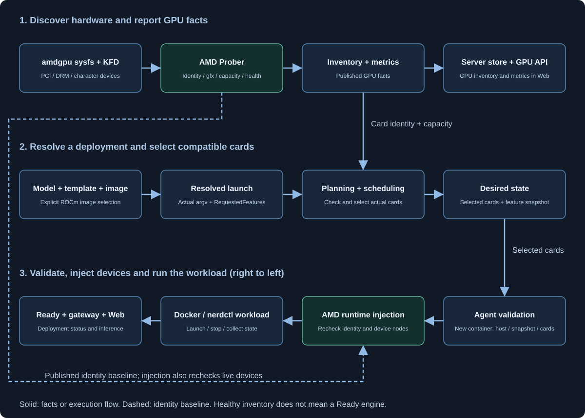

# AMD 支持设计

本文说明 AMD 如何接入既有探测、规划、调度与运行时，以及共享接口的兼容边界。操作步骤见 [AMD 硬件验收](amd-hardware-validation.md)，启动配置的权威来源见 [ADR 0020](../adr/0020-launch-config-single-source.md)。

## 目标与范围

当前 GPUWorks AMD 实现面向 Linux amd64、Docker/nerdctl 整卡部署，单机或 vLLM 多机（PP 与跨机 TP，RCCL 走 NCCL_* 网络变量）。内置规格按 `arch_id` 限定 gfx942（MI300X/MI325X）与 gfx1151（AMD395）。sleep 与 PD（`vllm-nixl`，UCX）已实现并在 MI300X 上验证；数据并行、显存分区尚未实现；这不是 AMD 硬件或 ROCm 的永久能力结论。物理统一内存不启用 Apple 的按内存共享分配策略。

## 数据流与事实来源

`Inventory + metrics` 向右供 API/Web 展示，向下给逐卡规划提供身份和容量。下排执行流程从右向左；虚线将已发布的探测身份交给注入模块，与当前设备再次比较。库存健康与引擎 Ready 是不同事实。

| 事实 | 唯一所有者 | 消费方式 |
|---|---|---|
| 厂商身份、PCI 常量、平台约束、宿主要求 | `internal/accelerator` | 约束表声明事实，不用厂商开关选择第二套准入流程。 |
| PCI/UUID、DRM/render、KFD/gfx、容量与实时读数 | agent 的 Prober | 库存发布身份基线；注入重新检查当前设备。DRM index 不是 HIP ordinal。 |
| 引擎参数词表与功能识别 | `internal/engines` | 只检查解析后的真实 argv；不重新解释 shell 文本。 |
| 生成命令与 RequestedFeatures | `deploy.ResolveLaunch` | 功能随现有 ResolvedLaunch 快照传递，agent 消费该快照。 |
| 逐卡兼容、选卡与资源占用 | planning、scheduler、controller | API 候选与实际调度共用拒绝工厂；单节点错误只拒绝该节点。 |
| 分区能力与用户拒绝文案 | `partitioncap` | 不在 accelerator 中维护第二个 FeaturePartition。 |
| 模板硬件匹配与预览落点 | 服务端 chipmatch / planning | 浏览器展示服务端结果，不复制正则、unsupported 或特异性规则。 |
| 基础镜像与模型事实 | runner matrix / 种子目录 | AMD 规格与其他厂商一样直接写在种子目录里，引用 runner matrix 发布的 ROCm 镜像。 |

## 探测、缓存与并发

AMD 探测读取 sysfs/KFD，不引入 cgo 或宿主 ROCm CLI 依赖。PCI 厂商和 amdgpu 驱动绑定不足以把 AMD 加入厂商清单，还须有匹配的 KFD 计算节点。自动选择 AMD 前检查一次总线快照：其他厂商的非 VFIO 卡存在时，保留其探测失败/回退路径，不把 AMD 核显作为替代加速器。管理员的显式厂商选择仍走产品已有流程。

健康计算库存要求明确架构、唯一 PCI/UUID/index、KFD 及 render 字符设备映射。缺事实、重复身份、多 render 歧义与设备号不符均不能成为已验证可调度设备。附加错误保留已有诊断；单卡故障不抹掉其他卡的可读库存。

KFD 属性只解析用于身份匹配与容量判定的非负整数字段；这些字段缺失、格式错误、重复或超出内部表示范围时仍拒绝使用。其他内核元数据不参与判定，例如无符号 64 位的 `unique_id`、`debug_prop`，不能因其超过有符号整数范围而丢弃整张卡。该边界由合成 ABI 用例覆盖，不等同于新硬件实测。

指标读取复用短期静态拓扑快照，TTL 为 15 秒，覆盖十秒的常规采集间隔。每次仍实时核对设备身份、容量来源并读取利用率、温度、功耗和内存占用；采集前后身份不一致则丢弃该卡读数。指标调用不能发布替换卡为新身份基线。启动注入不依赖指标缓存，始终核对当前设备。

共享有界读取 helper 限制 sysfs 在途调用；锁仅保护快照交换，不包住 I/O。调用方可以超时返回，但内核读取未返回前仍占用限流槽位。无法取消的内核调用是明确限制，不能靠反复重试增加 goroutine。

## 通用逐卡准入

所有厂商使用同一条逐卡准入路径。只有出现实际参与准入的候选，才在该评估/调度周期内加载一次全局模型并准备目录和启动输入；离线、禁止调度或不满足节点条件的池不触发这次读取。该周期串行持有的缓存按实际硬件和配置形态保存纯解析的功能快照或拒绝结果，坏模板也不会逐节点重解析。具体节点的模型与组件路径在缓存之外、实际启动时校验；缺文件只拒绝该节点，不使整个节点池失效。实际创建使用相同 resolver 重新生成真实启动命令。全局模型记录缺失、共享模板配置无效与节点错误分开处理：前者使评估明确失败，逐卡或节点文件错误只拒绝相应候选。共享准入对象由一次串行池扫描持有，结束后检查其全局错误。

资源/配额预览可显式允许镜像尚未选定，继续使用同一 resolver 解析可知的启动事实，但不生成虚构镜像或拉取计划。该许可仅在 preview 生效；真实创建及未授权的预览仍必须满足镜像合同。

引擎 adapter 生成最终 argv，叶子包识别它请求的 PP、DP、sleep、多机、PD 和 KV 磁盘层功能；结构化拓扑与声明一起形成 RequestedFeatures。它不是新的数据库独立事实，而是现有不可透明查询的 ResolvedLaunch 快照的一部分。agent 不复制引擎参数词表，只检查快照、宿主和选卡合同及显式结构字段的一致性。

未知命令以 `CommandKnown=false` 表示，不能等同于没有请求高级功能。显式列有受限启动功能的目标需要可识别的引擎入口，否则返回 `launch_features_unknown`，引导使用可识别入口与结构化参数。未声明该限制的 NVIDIA、Ascend 等继续接受原有自定义入口；Apple 的 deny-all 功能声明不会误拒普通推理。历史 desired state 缺少快照时保留旧结构字段的兼容检查，不声称已验证未知 argv。准备 hook 和动态 shell 不由准入层反向解析。

宿主不匹配返回带类型的内部结果，再由 messages 展开成稳定参数。缺事实与已知不支持分开报告。未知 `target_vendor` 返回 400；AMD 默认镜像为空，是因为通用默认镜像使用 CUDA，必须选择已核验的 ROCm 镜像或模板。

## agent 生命周期与原子注入

agent 先处理运行中容器的接管，再解析持久化卡身份；仅在真正新建时执行目标准入。不能因新规则把仍在运行的旧容器标成失败而不处理容器，也不能在绑定卡重建 GPUIndexes 前误拒空索引。校验与启动使用同一个已捕获运行时驱动。

AMD 注入比较已发布身份、当前 PCI/UUID、该 PCI 设备的 `drm/renderD*`、sysfs major/minor 与字符设备 Rdev。只注入 `/dev/kfd` 与选中 render 节点，不猜 HIP ordinal。空选择或歧义拒绝创建。

所有厂商的 RuntimeInjection 都在 workload 副本上应用并一次提交。需要替换旧配置的注入器以类型化 ManagedSelection 声明受管环境变量、选项与设备路径；没有声明则仅应用新增值，但也不原地修改输入。失败不留下部分变化。精确清理保留 InfiniBand 等无关设备。此合同落实平台分配，不构成管理员自定义 privileged 容器的安全沙箱。

## 对其他厂商的影响与拆分

| 模块 | 影响范围 | 必要性与保护 |
|---|---|---|
| 逐卡功能准入、宿主结果与功能快照 | 所有厂商共用接口 | 消除节点级与 AMD 逐卡平行判断；保留普通 NV/Ascend 命令和生命周期，用相同场景比较基线与候选。 |
| 原子注入合同 | 所有注入器 | 去掉隐式模式切换；已有设备、环境与参数输出保持一致，不再修改调用方 map。 |
| AMD 探测、KFD/GTT、ROCm 注入 | AMD 私有实现 | 不依赖 Kunlun、NVIDIA 或 Ascend 的后端。 |
| arch_id、服务端模板选择、已选目录行 | 共享目录合同 | API 预览、创建与执行消费相同匹配结果与模型事实，架构拒绝带要求值和实测值。 |
| 容量已知标识与厂商品牌展示 | 共享 DTO/UI | 派生的 memory_capacity_known 不落库；未知显示“—”，实测零占用不丢失；品牌只查公共翻译字典。 |
| AMD 镜像与启动覆盖项 | AMD 数据 | runner matrix 为基础镜像唯一来源，模型配置与权重从种子目录继承。 |

本次接入不改 SGLang hybrid/Mamba 估算、显式 token 上限规则、共享 Qwen3.8 模型事实、GPU 遥测时间窗/UUID 匹配、部署健康派生、CI 日志包装或默认 fleet GPU 读取开关。这些原先混入的全厂商变更需独立问题、基线对照和评审；保留主线行为不表示主线已解决所有相关缺陷。

## 内存、镜像与模型合同

AMD395 UMA 仅在 PCI 0x1586、gfx1151、唯一 KFD/PCI/render 关系与 KFD system-memory bank 和 GTT total 一致时报告驱动公开池。事实缺失或冲突时容量未知并降级，不把 dedicated carve-out 当作健康容量。GTT used 不含全部宿主占用，total−used 不能当作 HIP 当前 free；真实内存压力和 OOM 仍须专项验证。

AMD 规格与其他厂商的规格同在种子目录，模型配置、来源与权重与同模型其他规格一致，镜像引用官方 ROCm runner。

ROCm 基础镜像、版本和 Dockerfile 选择由 runner matrix 唯一维护。vLLM 档已构建、发布并经 MI325X 与 AMD395 真机验证；SGLang 档仍是未发布候选。没有实际构建、拉取和真机证据时，不扩大声明。

工具只连接明确指定、事先授权的运行时，不启动第二个 dockerd、不全局 prune。独立 socket/data-root 不构成网络隔离；另一个 daemon 须使用独立 VM 或在启动前证明独立 network namespace。

## 验证边界与后续扩展

| 场景 | 所需证据 |
|---|---|
| 核显误判、厂商探测失败、身份替换与阻塞 sysfs | 正常前置条件、真实失败注入及有界并发/取消测试。 |
| 一个坏节点、混合厂商、缓存形态 | API/controller 一致拒绝；其余节点可选；解析次数与形态数一致。 |
| NVIDIA/Ascend/AMD Web 生命周期 | 真实浏览器、server、SQLite、agent 与 HTTP engine fixture；核对请求、持久化、Ready、聊天和停止。 |
| 规模 | 显式含 AMD 比例的 200 节点 churn，基线/候选同负载比较 CPU-seconds、RSS 和失败数。 |
| HIP/ROCm、模型质量、长上下文、OOM、多卡隔离 | AMD 真机、实际镜像与真实权重，CPU 仿真不能替代。 |

新增 AMD 型号、分区或 sleep/PD 前，补对应设备、引擎与失败路径证据，再调整能力数据与 backend。当前软件通过不继承历史退租 AMD 机器的验收结论，也不把单张 AMD395 的结果推广到 MI300 或其他 ASIC。
