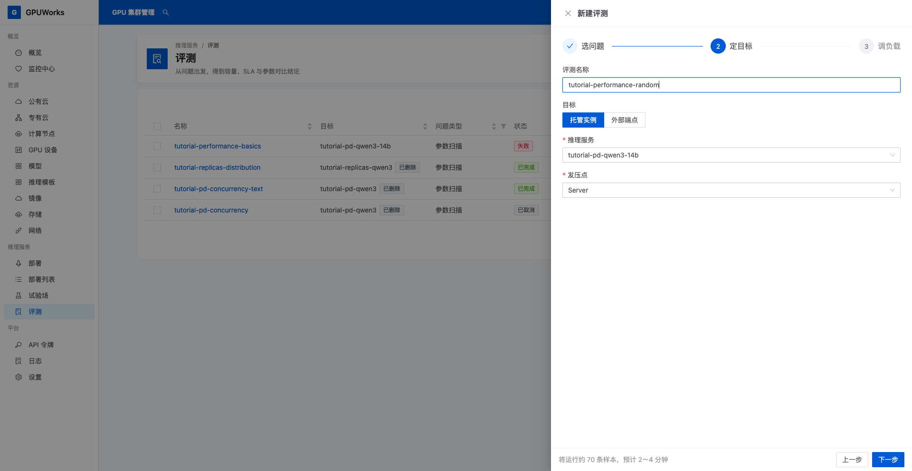
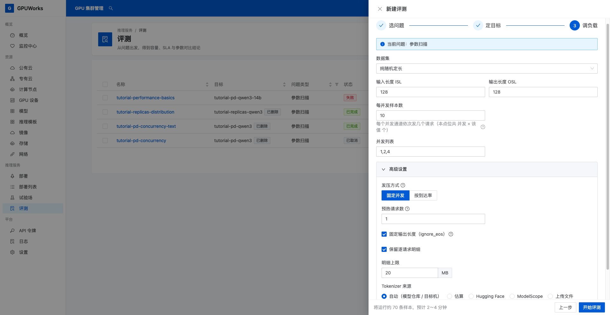
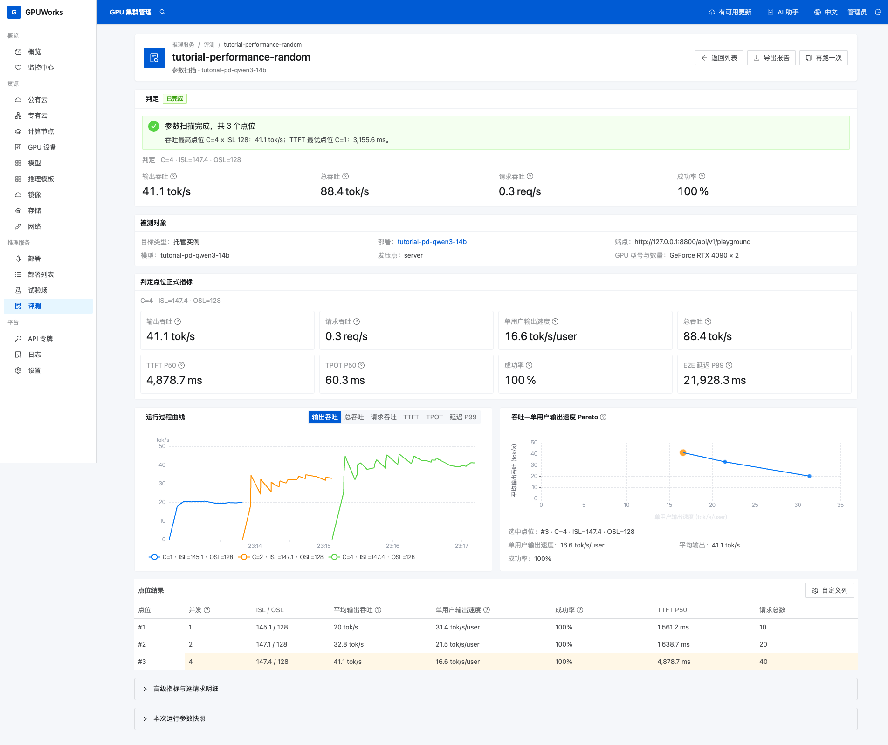

# 运行一次性能评测并读懂报告

模型服务已经能回答问题后，可以用内置的 **纯随机定长**负载运行一次性能评测。本教程向你指定的服务发送并发 `1、2、4` 的请求，查看成功率、首字等待、单用户输出速度和整体吞吐，最后保存报告。

## 开始之前

- 有查看部署、创建评测和下载报告的权限。
- 有一个已运行的托管对话服务，使用非思考模型或已关闭思考输出，在 **试验场 → 对话**中能够正常流式返回正文；记下服务名。
- 留出独占测试时段，暂停该服务的其他业务请求和评测。发压会占用服务资源。

本文截图和数据使用 `tutorial-pd-qwen3-14b`，模型为 `Qwen/Qwen3-14B`，引擎为 vLLM `0.30.0`，服务已关闭思考输出。跟随操作时选择自己的服务，无需先完成其他教程。

纯随机定长由平台生成输入，适合学习发压与读报告，不需要准备或上传数据集。随机输入不代表业务问题，这次评测也不评价回答是否正确。

## 1. 指定被测服务

1. 打开 **推理服务 → 评测**，点击 **新建评测**。
2. 在 **选问题**中选择 **参数扫描**。
3. 在 **定目标**中按下表填写，点击 **下一步**。

| 字段 | 填写内容 |
|---|---|
| **评测名称** | `tutorial-performance-random`，也可填写自己的名称 |
| **目标** | **托管实例** |
| **推理服务** | 选择开始前确认可调用的服务；截图使用 `tutorial-pd-qwen3-14b` |
| **发压点** | **Server** |

**Server** 发压会经过服务网关，再按部署方式路由。本例的服务采用 PD，普通单机或多副本服务也适用。服务不在列表时，回到部署详情确认实例已运行、未休眠，再检查试验场调用。

## 2. 配置内置随机负载并开始

1. 在 **调负载**中，将 **数据集**选择为 **纯随机定长**，填写以下参数。

| 字段 | 值 | 含义 |
|---|---|---|
| **输入长度 ISL** | `128` | 每个请求的目标输入 token 数 |
| **输出长度 OSL** | `128` | 每个请求的目标输出 token 数 |
| **每并发样本数** | `10` | 每个并发通道依次发送 10 个请求 |
| **并发列表** | `1,2,4` | 依次运行三个点位，同时在途请求数分别为 1、2、4 |

2. 展开 **高级设置**，核对以下配置。

| 字段 | 值 |
|---|---|
| **发压方式** | **固定并发** |
| **预热请求数** | `1` |
| **固定输出长度（ignore_eos）** | 勾选 |
| **保留逐请求明细** | 勾选 |
| **明细上限** | `20 MB` |
| **Tokenizer 来源** | **自动（模型仓库 / 目标机）** |

固定并发会在一个请求完成后补发下一个请求。三个点位分别发送 `10、20、40` 个正式请求，共 `70` 个；另有 `1` 个预热请求，其结果不计入点位。固定输出长度要求引擎忽略提前结束信号，生成到目标长度。

自动模式从目标机或模型仓库取得 Tokenizer，用于生成目标长度的随机输入。本次解析为 `ms://Qwen/Qwen3-14B`。聊天模板可能增加输入 token，以报告中的实际 **ISL / OSL**为准。

3. 点击 **开始评测**，进入详情页，在 **被测对象**中核对服务名和发压点 `server`。

如果提示目标上已有评测在运行，点击 **取消**并等待其结束。若服务因不支持 `ignore_eos` 返回错误，关闭固定输出长度再跑，并按报告中的实际 OSL 解释结果，不能假定每条都生成了 128 个 token。

## 3. 从四个维度读报告

1. 等待状态变为 **已完成**，确认 **点位结果**有并发 `1、2、4` 的三行，请求总数分别为 `10、20、40`。
2. 点击 **自定义列**，显示 **并发**、**ISL / OSL**、**请求总数**、**成功率**、**TTFT P50**、**单用户输出速度**和**平均输出吞吐**。
3. 逐行查看下表中的四个维度，再比较并发变化时它们如何变化。

| 维度 | 看哪项 | 如何理解 |
|---|---|---|
| 请求是否成功 | **成功率** | 本点位成功请求占比；有失败时先查看错误和明细 |
| 首字要等多久 | **TTFT P50** | 从发出请求到收到首 token 的等待，包含排队和提示处理；P50 是这批请求的中位数 |
| 开始回答后有多快 | **单用户输出速度** | `1000 ÷ TPOT P50（ms）`，单位 tok/s/user；不含首 token 前的等待 |
| 整个服务每秒输出多少 | **平均输出吞吐** | 本点位成功请求的输出 token 总数，除以从首个请求发出到最后一个请求完成的时长 |

不要用整体吞吐除以并发代替单用户输出速度。整体吞吐提高时，单个请求的首字等待仍可能变长，需要一起看。

以下是 2026-10-20 运行 `tutorial-performance-random` 的实测结果，三个点位成功率均为 `100%`。操作时记录自己服务的数值。

| 并发 | 成功 / 总请求 | TTFT P50（ms） | 单用户输出速度（tok/s/user） | 平均输出吞吐（tok/s） |
|---|---|---|---|---|
| `1` | `10 / 10` | `1561.21` | `31.38` | `20.04` |
| `2` | `20 / 20` | `1638.67` | `21.51` | `32.80` |
| `4` | `40 / 40` | `4878.68` | `16.59` | `41.07` |

从并发 `1` 到 `4`，平均输出吞吐从 `20.04` 增至 `41.07 tok/s`，约为原来的 `2.05` 倍；同时，单用户输出速度从 `31.38` 降至 `16.59 tok/s/user`，首 token 等待的中位数从 `1.56` 秒增至 `4.88` 秒。这说明整体输出更多，并不表示每个用户都获得了更快的回答。

本次各点位平均实际输入长度为 `145.10–147.43` token，输出长度均为 `128` token。目标输入长度与实际值不同，读报告时应连同实际长度一起记录。

若任务失败或只有部分点位完成，先查看错误并重跑；已有输出 token，但吞吐和计时均为 `0`时，保留明细排查，不能把它解释为零延迟。更多指标见[运行评测并解读报告](../how-to/benchmark.md#指标口径)。

## 4. 保存报告

1. 点击 **导出报告 → 下载独立 HTML（含图表）**，打开下载文件，确认能查看三个点位；需要表格数据时再选择 **下载 CSV**。
2. 展开 **本次运行参数快照**，点击 **复制完整参数快照**，连同报告保存，保留服务、模型、镜像、负载和并发配置。
3. 需要复测时点击 **再跑一次**，核对服务与参数后开始。比较两轮结果时，记录并控制计划改变的条件。

**完成条件**：三个点位运行结束；能从报告说明请求是否成功、首字等待多久、开始生成后有多快，以及整个服务的吞吐；已保存可重新打开的报告。

这次小规模随机负载用于学习性能评测，不给出业务容量结论。评估业务容量时，先明确业务可接受的成功率和响应时间，再采用有代表性的业务样本与输入输出长度，增加请求数并重复测试。
