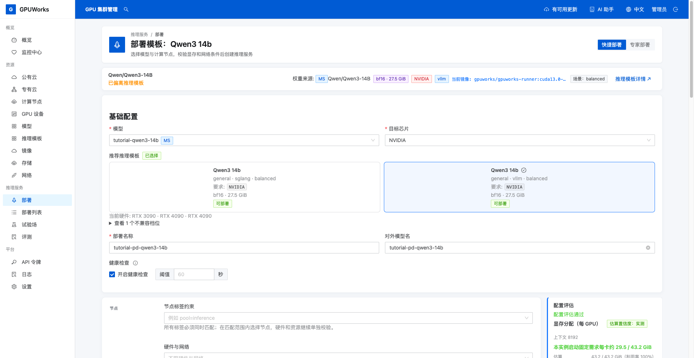
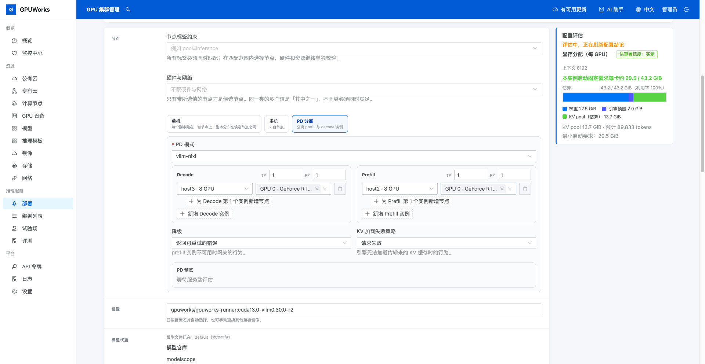
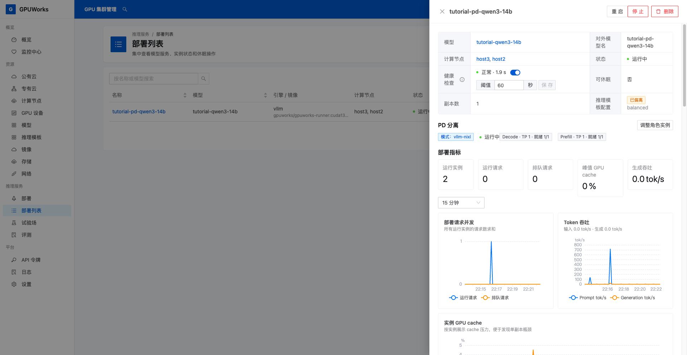
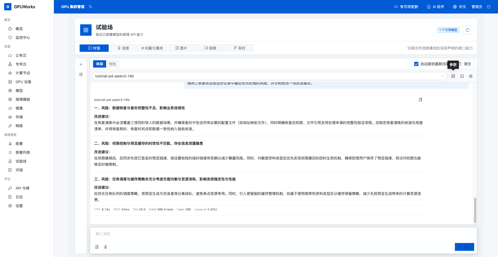
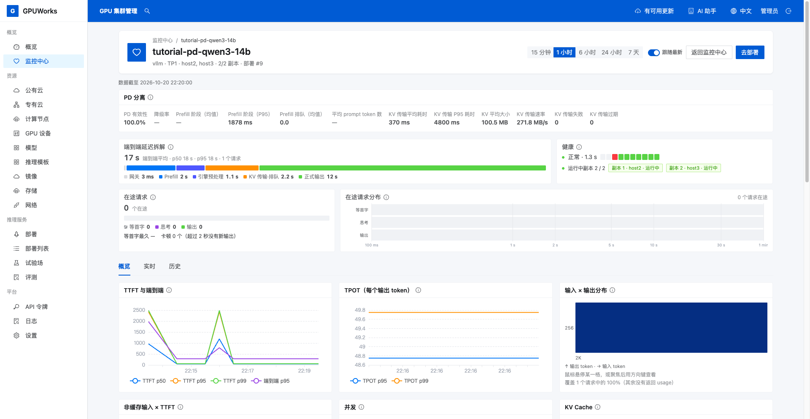
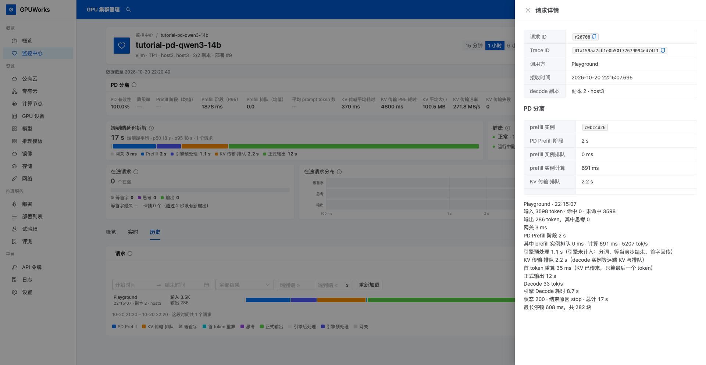
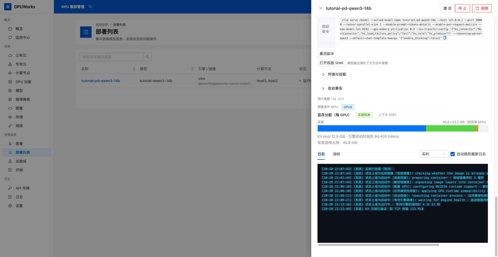

# 部署 PD 服务并观测请求链路

本教程使用两台 NVIDIA GPU 节点部署 `Qwen/Qwen3-14B`：Prefill（P）负责提示计算，Decode（D）负责逐 token 生成。完成后，你将能发起一次长文总结请求，并通过角色状态、请求详情和 KV 交接日志判断 PD 链路是否工作。

## 开始之前

| 你需要 | 本文使用的配置与检查位置 |
|---|---|
| 控制台与权限 | 能查看节点、登记模型、导入推理模板、创建部署、使用试验场和监控中心 |
| 两台可用节点 | 两台节点已接入且在线，各有一张空闲的 RTX 4090（48 GiB）；本文节点显示名称为 `host2`、`host3`，均选 GPU `0` |
| 软件环境 | Server、Agent 为 `dca20f6d`，运行时 runveil，NVIDIA 驱动 `610.57.04`；节点环境在 **计算节点**详情核对 |
| 模型文件 | 两台节点已有完整的 `Qwen/Qwen3-14B` BF16 文件；本文目录均为 `/model/ModelScope/Qwen/Qwen3-14B` |
| 镜像 | `gpuworks/gpuworks-runner:cuda13.0-vllm0.30.0-r4`，两台节点均已取得 |
| 网络与磁盘 | 两节点可互通；本文使用 `eth0` 管理网。模型目录所在文件系统及运行时所在文件系统都有足够空间，能够容纳权重、镜像解包和运行日志 |

这里的 `48 GiB` 是本次节点的实际显存容量，操作时以 **GPU 设备**中显示的容量为准。P、D 各自加载完整模型，分别检查显存是否足够。

操作时选择自己的对应节点，并将模型目录替换为节点上的实际绝对路径。模型还未准备好时，可按[下载、缓存和节点间同步模型](../how-to/download-and-sync-models.md)准备；节点连接与网络配置分别见[接入计算节点](../how-to/connect-nodes.md)和[节点网络指南](../how-to/configure-networks.md#管理网)。

## 1. 登记模型并导入示例模板

1. 打开 **GPU 设备**，检查两个所选 GPU 没有占用实例，且显存充足。
2. 打开 **模型 → 注册模型**，**来源**选择 **ModelScope**，**来源 ID**填写 `Qwen/Qwen3-14B`，**名称**填写 `tutorial-qwen3-14b`，点击 **确认注册**。已有同一模型登记项时直接使用。
3. 在模型卡片点击文件夹图标 **登记计算节点路径**，选择 `host2`，填写已有目录 `/model/ModelScope/Qwen/Qwen3-14B`，点击 **登记**；对 `host3` 重复此操作。进入模型详情的 **模型文件**，核对两个节点、登记路径和 **可用**状态。
4. 下载 [qwen3-14b-vllm-template.yaml](../assets/examples/qwen3-14b-vllm-template.yaml)，打开 **推理模板 → 导入模板**，选择该文件。看到 **模板已导入**后，进入 Qwen3-14B，打开 NVIDIA vLLM 用户档位的 **详情**，在 **运行配置 → 档位标识**中确认 `bf16-vllm-nvidia-tutorial`。

登记节点路径会采用已有文件，不会复制或移动它们。若目录缺失、不可读或尚未下载完整，先处理文件问题再登记。

示例模板使用 BF16、vLLM 0.30.0，并默认关闭思考输出，便于直接观察正文生成。导入会新增一个用户档位，保留原有官方条目；后续选择本教程的档位即可。

## 2. 选择模型与推理模板

1. 打开 **部署 → 快捷部署**，在 **基础配置**选择 `tutorial-qwen3-14b`，**目标芯片**选择 **NVIDIA**。
2. 在 **推荐推理模板**中选择 Qwen3-14B 的 **general · vllm · balanced** 档位，核对 **bf16** 标签。若有多个同名档位，回到 **推理模板**，从上一步已核对标识的用户档位点击 **部署**。出现 **使用已登记的模型？**弹窗时，选择自己的 `Qwen/Qwen3-14B` **MS** 登记项，点击 **使用此模型并部署**。
3. 核对来源 ID 为 `Qwen/Qwen3-14B`，当前镜像为 `gpuworks/gpuworks-runner:cuda13.0-vllm0.30.0-r4`。
4. **部署名称**和**对外模型名**均填写 `tutorial-pd-qwen3-14b`，保留开启健康检查。如果名称已被占用，换一个未使用的名称，并在后续调用和监控中选择同一服务。



## 3. 配置 P、D 角色和资源

1. 在下方 **节点**区域选择 **PD 分离**，**PD 模式**选择 `vllm-nixl`。
2. 按表格配置两个角色。页面先显示 **Decode**，再显示 **Prefill**；每个角色保留一个实例，每个实例只选一台节点。

| 角色 | 节点 | GPU | TP | PP | 实例数 |
|---|---|---|---|---|---|
| **Decode** | `host3` | `0` | `1` | `1` | `1` |
| **Prefill** | `host2` | `0` | `1` | `1` | `1` |

3. **降级**选择 **返回可重试的错误**，**KV 加载失败策略**选择 **请求失败**。这样 P 不可用或 KV 交接失败时，请求会失败，便于发现分离链路的问题。
4. 核对下方资源与参数配置，保留模板启动方式。

| 字段 | 值 |
|---|---|
| **最大上下文长度** | `8192` |
| **显存使用率** | `0.90` |
| **可休眠** | 关闭 |
| **dGPU 显存** | 不启用 |
| **KV Offload** | 关闭 |



5. 等待右侧显示 **配置评估通过**，在 **PD 预览**中核对两个角色的节点、GPU 均正确且显示 **可容纳**。若评估报资源、网络或配置错误，按提示处理并重新评估。

配置评估用于检查能否提交；镜像解包、模型加载和实际推理仍需在部署后确认。

## 4. 提交并观察两个角色

1. 点击 **部署**，在 **部署列表**打开 `tutorial-pd-qwen3-14b`。
2. 等待容器启动、模型加载及健康检查完成，核对 **Prefill**、**Decode**均为 `1/1` 就绪，两个实例均显示 **运行中**。
3. 打开两个实例的详情，分别核对 P 在 `host2` GPU `0`、D 在 `host3` GPU `0`。两个角色都就绪后再发起调用。



若实例失败，在其 **日志**中查看原因。磁盘不足时先补足空间；模型仍在加载时等待其完成。处理原因后，若页面提示已停止重试，点击该实例的 **重试**。其他启动问题见[排障指南](../how-to/troubleshooting.md)。

## 5. 在试验场总结一篇长文

1. 打开 **试验场 → 对话**，点击 **新对话**（加号），选择 `tutorial-pd-qwen3-14b`。没有出现时，点击 **刷新模型**，并回到部署详情确认两个角色已就绪。
2. 点击模型选择框右侧的 **参数**，勾选 **最大输出 Token**，填写 `1024`。这是输出上限，回答可以提前结束。
3. 打开 [long-prompt.txt](../assets/examples/long-prompt.txt)，复制文件中的全部文字到消息框，再换行追加以下问题。记下当前时间并点击 **发送**。

   ```text
   请用三条要点总结这份记录中最应优先处理的风险，并分别给出一项改进建议。
   ```

4. 等待生成结束，确认显示正常回答且没有请求错误。长文是合成练习材料，回答只需围绕材料完成总结，不要求逐字一致。



本次请求实际输入 `3598` 个 token，输出 `286` 个 token，思考 token 与缓存命中 token 均为 `0`，在 `8192` 上下文范围内。自己的 token 数与回答可能不同，在下一节的请求详情中核对；不要用文字字符数代替 token 数。

## 6. 观察服务状态并定位这次请求

1. 打开 **监控中心**，进入 `tutorial-pd-qwen3-14b` 的服务监控，选择包含刚才调用时间的窗口，查看顶部 **PD 分离**卡片。



| 观察项 | 如何读 |
|---|---|
| **PD 有效性**、**降级率** | 有效性表示 D 收到的提示 token 中经 KV 传输得到的比例；结合降级情况判断服务是否在使用分离链路 |
| **KV 传输平均耗时**、**KV 平均大小**、**KV 传输速率** | 查看当前窗口内的交接表现；这些汇总值不能当作某一条请求的传输量或耗时 |
| **KV 传输失败**、**KV 传输过期** | 留意是否出现异常，再结合对应时段的请求和实例日志排查 |

本次截图中 PD 有效性为 `100.0%`，KV 传输失败、过期均为 `0`。部分统计显示 `—`，表示当前窗口没有可显示的统计值，不能按 `0` 解读。

2. 切换到 **历史**，按刚才的调用时间找到 **Playground**请求并打开 **请求详情**。未出现时，检查顶部时间范围并点击 **重新加载**。
3. 核对 **接收时间**与本次调用一致，复制 **请求 ID**。在详情底部确认 **状态 200**和**结束原因 stop**。
4. 在 **PD 分离**及阶段明细中核对下列信息，确认有 P 参与且没有 **降级原因**。

| 观察位置 | 应核对什么 |
|---|---|
| **prefill 实例**与 **PD Prefill 阶段** | 存在 P 实例标识及 P 阶段耗时 |
| **decode 副本** | 对应本次承担生成的 D 实例 |
| **KV 传输·排队** | D 等待 KV 与排队的阶段，不能将整段直接当作纯网络传输时间 |
| **首 token 重算** | D 侧的 Prefill 计算；是否单独显示取决于引擎提供的数据与页面显示精度 |
| **正式输出**与请求结果 | 已生成正文，请求正常结束且未降级 |



本次请求为 `r20708`，Trace ID 为 `01a159aa7cb1e0b50f77679094ed74f1`。下表记录了它的主要阶段，页面可能按显示精度取舍。操作时记录自己的请求 ID 和耗时。

| 阶段 | 本次记录 | 含义 |
|---|---|---|
| 网关 | `3 ms` | 网关自身处理时间 |
| PD Prefill 阶段 | `1991 ms` | 网关等待 P 完成提示处理并返回交接信息的时间，其中 P 实际计算 `691 ms`、排队 `0 ms` |
| D 引擎预处理 | `1137 ms` | D 首 token 前未归入引擎排队和计算的部分 |
| KV 传输·排队 | `2151 ms` | D 等待远端 KV 与排队的合计 |
| 首 token 重算 | `35 ms` | D 取得 KV 后的首 token 计算 |
| 正式输出 | `11595 ms` | 从首个正式答案 token 到最后一块文字 |
| 全程 | `16912 ms` | 从网关收到请求到这次请求结束 |

本次记录显示 P 完成提示计算，D 接续生成正文，请求以 `200 / stop` 结束且没有降级。P 的实际计算时间包含在 PD Prefill 阶段内，不要重复相加；KV 传输与排队也不是纯网络传输时间。这些数值用于理解本次链路，不据此推断 PD 比普通部署更快。

如果出现 **降级原因**、请求错误或无法确认 P 参与，先保留请求 ID，再结合下一节的实例日志排查，处理后重新调用。

## 7. 查看 KV 交接自检与日志

1. 回到 **部署列表 → tutorial-pd-qwen3-14b**，打开 Prefill 实例的 **日志**，选择 **实时**，查找系统事件 **KV 交接已验证**（`PD_HANDOFF_VERIFIED`）。
2. 记录事件里的传输方式和传输量，并核对对应实例。本例使用以太网，实际结果应与节点网络一致；若结果为 `unmeasured`，表示未测得传输字节数，仍需补充交接证据。
3. 分别打开 P、D 实例的日志，选择 **1 小时**等包含启动和调用时间的历史范围，查看引擎持久化日志，检查是否出现 KV 交接失败或引擎错误。日志行的时间前缀是服务端采集时刻，可能与引擎内置时间不同。
4. 在 D 实例日志中查找 `KV Transfer metrics`，查看 `Num successful transfers`（成功次数）、`Avg xfer time (ms)`（平均传输耗时）、`Avg MB per transfer`（平均传输大小）和 `Throughput (MB/s)`（吞吐）。这些是日志统计区间内的值，未带请求 ID 时不能归为某一条请求的精确传输数据。



本次自检记录 `transport=tcp`、`bytes=117964800`，即 `112.5 MiB`，界面取整显示为 `113 MiB`。这个字节数属于部署自检，不是请求 `r20708` 的传输量，也不代表 RDMA 已验证。

**KV 交接已验证**是部署自检证据；第 6 节的请求详情记录本次长文调用。日志中的 HTTP `200` 也可能来自健康检查，不能仅凭一条成功日志认定它属于本次长文；本次参与的 P、D 以请求详情为准。

**完成条件**：P、D 各有一个就绪实例；长文总结调用成功；请求详情显示 P、D 参与且未降级；能够找到 KV 交接自检结果，并打开对应实例日志核对异常。阶段耗时用于理解这次调用，性能表现仍取决于模型、网络和业务负载。

更多模式、扩缩和监控说明见 [PD 分离部署操作指南](../how-to/pd-disaggregation.md)。
