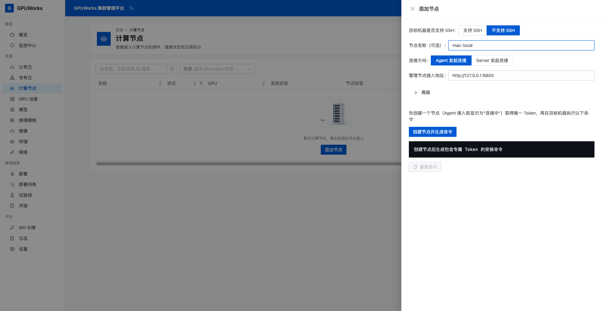
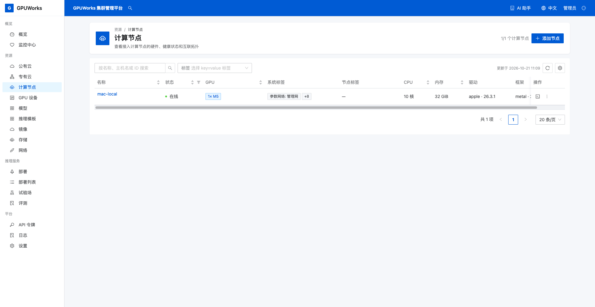
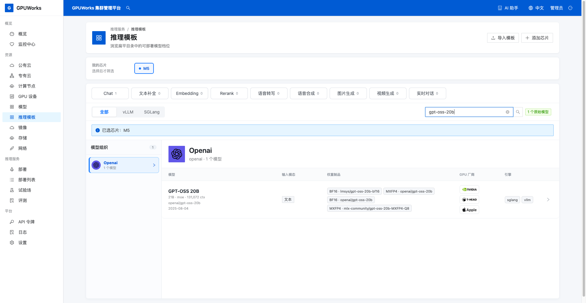
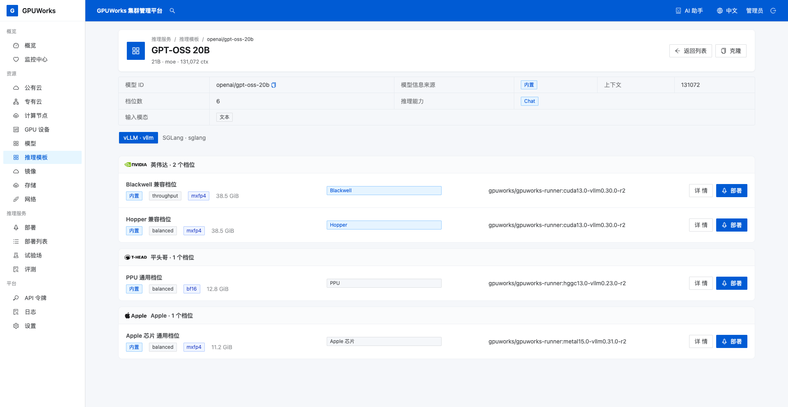
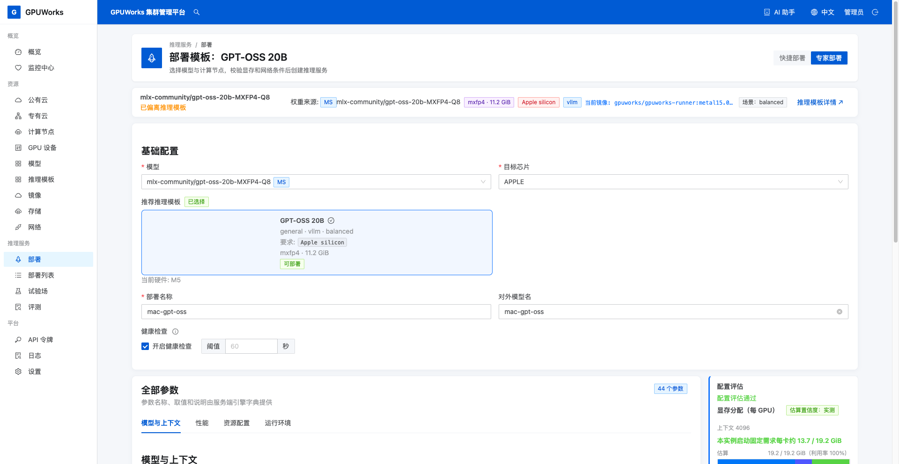
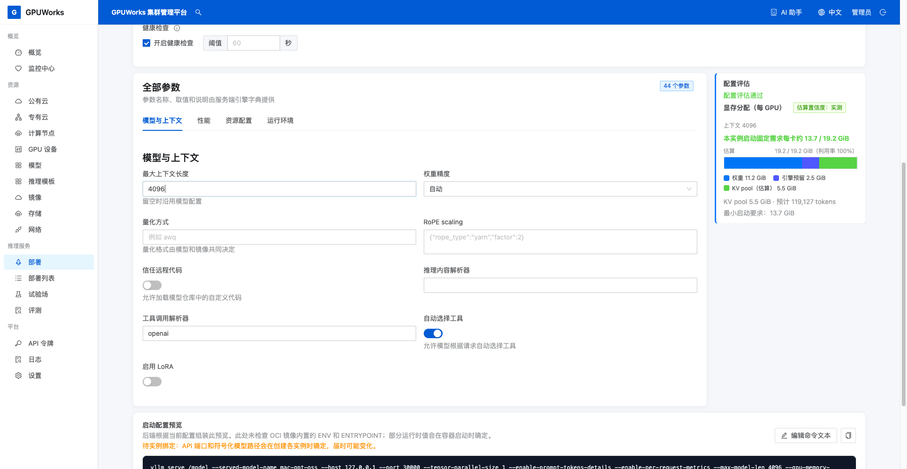
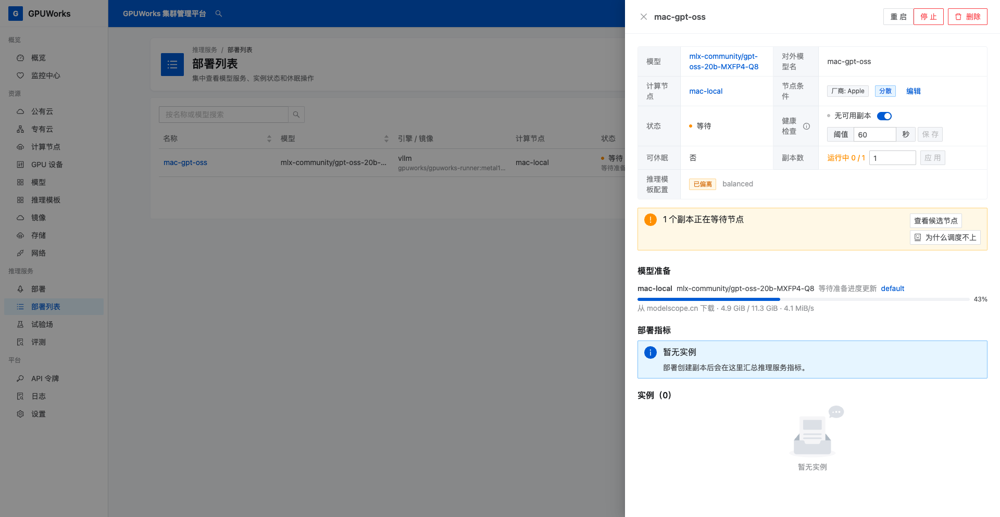
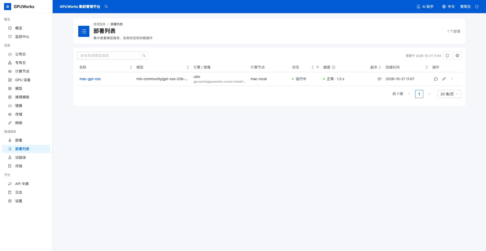
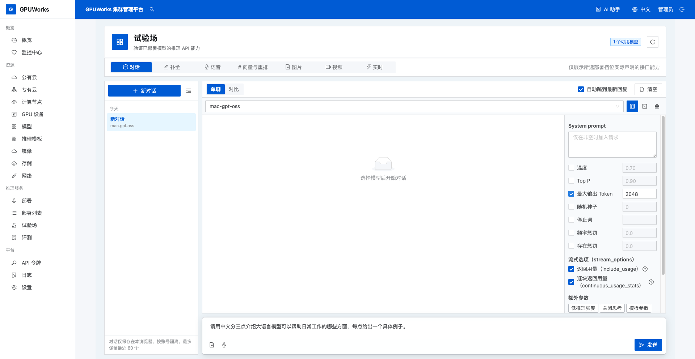
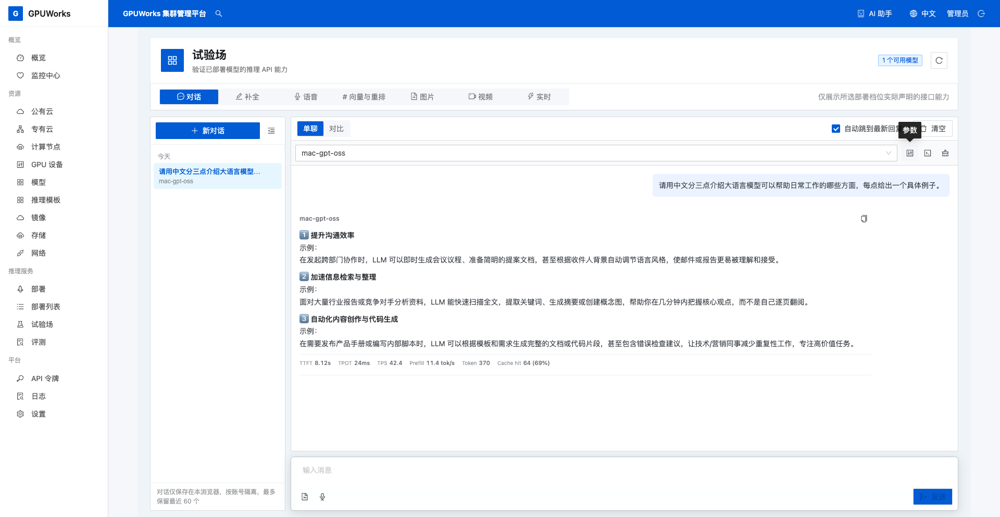

# 在 Mac 上运行第一个本地模型

在一台 Apple silicon Mac 上安装 GPUWorks，把本机接入控制台，从推理模板选择模型并完成第一次本地对话。本文面向首次安装和本地试用，用完后可以停止模型以释放资源。

## 开始之前

- 一台 Apple silicon Mac，macOS 15 或以上。GPUWorks 也提供 Intel Mac 安装包；本教程的模型与部署步骤仅适用于 Apple silicon Mac。
- 能使用终端和浏览器，必要时可在终端输入本机管理员密码。
- 能访问 GPUWorks 发布源、ModelScope 和推理环境包仓库，并有足够磁盘存放下载与解包后的文件。
- 本文用于新的本地试用环境；已有 GPUWorks 安装时，先按[安装和升级控制面](../how-to/install-server.md)确认现有目录和服务，避免重复安装。

本文示例使用 **Apple M5、32 GiB 统一内存、macOS 26.3.1、GPUWorks nightly b40eddfc**，Agent 安装命令以该版本为准。模型下载约 `11.3 GiB`，还需为推理环境包的下载、解包和运行数据保留空间；其他设备以实际配置评估为准。

控制台和推理节点都在这台 Mac 上。Mac 使用 `host` 运行时，推理引擎作为本机进程运行，GPUWorks 下载适配 Metal 的环境包，无需安装 Docker Desktop。统一内存也由系统和其他应用使用，部署时以平台探测到的可用容量和配置评估为准。

## 1. 下载发布包并安装控制台

1. 在这台 Mac 的终端中创建下载目录，取得 nightly 当前版本的 Apple silicon 发布包与校验文件。

   ```bash
   mkdir -p "$HOME/Downloads/gpuworks-mac"
   cd "$HOME/Downloads/gpuworks-mac"
   GPUWORKS_SOURCE=https://gpuworks-dl.oss-cn-shanghai.aliyuncs.com
   GPUWORKS_RELEASE=$(curl -fsSL "$GPUWORKS_SOURCE/nightly/latest")
   GPUWORKS_PACKAGE="gpuworks-$GPUWORKS_RELEASE-darwin-arm64"
   curl -fLO "$GPUWORKS_SOURCE/releases/$GPUWORKS_RELEASE/$GPUWORKS_PACKAGE.tar.gz"
   curl -fLO "$GPUWORKS_SOURCE/releases/$GPUWORKS_RELEASE/SHA256SUMS"
   shasum -a 256 -c SHA256SUMS --ignore-missing
   ```

   确认下载的 `darwin-arm64.tar.gz` 显示 `OK` 后再继续；校验失败时重新下载。nightly 是滚动预览渠道，命令会取得执行时的当前发布版本。

2. 解压并查看版本，然后安装到当前用户目录。

   ```bash
   tar -xzf "$GPUWORKS_PACKAGE.tar.gz"
   cd "$GPUWORKS_PACKAGE"
   ./gpuworks version
   ./gpuworks install --addr 127.0.0.1:8800 --quiet
   ```

   `--quiet` 跳过安装提问，新安装使用随机管理员密码并在最后摘要中交付。Mac 上默认安装到 `~/gpuworks/server`，以后台进程运行，不注册开机启动服务（需要时再执行 `~/gpuworks/server/gpuworks install --autostart`）；本次控制台只监听本机 `127.0.0.1:8800`。

3. 检查控制台已就绪。

   ```bash
   curl -fsS http://127.0.0.1:8800/healthz
   ```

   确认返回的 `status` 为 `ok`，浏览器打开 `http://127.0.0.1:8800`，使用 `admin` 和安装摘要里的随机密码登录。

## 2. 将这台 Mac 接入控制台

1. 打开 **计算节点 → 添加节点**，按下表填写。

| 字段 | 值 |
|---|---|
| **目标机器是否支持 SSH** | **不支持 SSH** |
| **节点名称** | `mac-local` |
| **连接方向** | **Agent 发起连接** |
| **管理节点接入地址** | `http://127.0.0.1:8800` |



2. 点击 **创建节点并生成命令**，复制完整命令，在末尾追加 `--no-sudo`，然后在这台 Mac 的终端执行。保留生成命令中的节点专属 Token。

   agent 和节点数据默认放在 `~/gpuworks`，与控制台的 `~/gpuworks/server` 互不覆盖。`--no-sudo` 使用用户级安装；正常情况下通过用户的 launchd 任务运行，只在该用户登录期间可用。若出现 LaunchAgents 权限错误，先按下方权限分支处理，再继续第 3 步。

3. 等待安装输出显示 `agent running under launchd`，回到 **计算节点**确认 `mac-local` **在线**。本例显示 `1× M5`、系统内存 `32 GiB`，运行时为 `host`。



系统的 `32 GiB` 是统一内存总量，不能全部视为可供模型使用的显存。本例平台探测到的 GPU 工作集约为 `21.3 GiB`，后续部署评估以 GPU 工作集及所选资源参数为依据。

### 出现 LaunchAgents 目录权限错误时

如果安装在写入 launchd 配置时出现类似 `open .../Library/LaunchAgents/.ai.gpuworks.agent...: permission denied`，在同一终端检查目录所属用户与权限：

```bash
ls -ld "$HOME/Library/LaunchAgents"
```

本次设备的该目录属于 `root`，当前用户无法写入。此时安装脚本已经把节点配置写入 `~/gpuworks`，可以直接将已安装的 agent 注册为系统级 LaunchDaemon：

```bash
sudo "$HOME/gpuworks/gpuworks-agent" install-service \
  --state "$HOME/gpuworks" \
  --user "$(id -un)"
```

按终端提示输入本机管理员密码。命令只为该 agent 注册系统服务，agent 仍以 `--user` 指定的当前用户运行；无需修改整个 `LaunchAgents` 目录的归属。看到 `agent running under launchd` 后，再确认控制台节点在线。系统级服务可以在用户未登录时启动。

其他接入问题见[接入节点](../how-to/connect-nodes.md#macapple-silicon节点)。

## 3. 从推理模板选择模型

1. 打开 **推理模板**，在 **我的芯片**中选择本机芯片（本例为 **M5**），搜索 `gpt-oss-20b`，打开 **GPT-OSS 20B** 详情。



2. 在 **vLLM** 页签下找到 **Apple 芯片 通用档位**，核对权重量化为 **mxfp4**、显示大小约 **11.2 GiB**，环境包为 `gpuworks/gpuworks-runner:metal15.0-vllm0.31.0-r2`，点击这一行的 **部署**。



3. 模型来源选择 **ModelScope**，确认仓库为 `mlx-community/gpt-oss-20b-MXFP4-Q8`，点击 **登记模型并部署**，进入部署配置。

权重大小不是运行时的全部内存占用，还要为上下文缓存、引擎和系统保留空间。下一步先检查配置评估，再提交部署。

## 4. 部署到本机

1. 在部署页面填写 **部署名称**和**对外模型名**，均使用 `mac-gpt-oss`。



2. 保持 **单机**、**自动选择**和 `1` 个副本。本例只有 `mac-local` 一个在线节点，核对评估选中的节点为本机。
3. 切换到 **专家部署**，在 **全部参数 → 模型与上下文**中，将 **最大上下文长度**改为 `4096`。其余参数使用所选模板默认值，包括 `gpu_memory_utilization=0.9`。



4. 等待右侧显示 **配置评估通过**，核对本机节点、GPU、环境包和内存需求，点击 **部署**。
5. 打开 **部署列表 → mac-gpt-oss**，观察模型文件准备、环境包获取及引擎启动进度，等待部署 **运行中**、健康 **正常**、副本数为 `1/1` 后再进入试验场。

首次部署需要下载模型和环境包，下载完成后仍要等待引擎加载模型。文件下载时，部署可能显示 **等待**、**无可用副本**和 `0/1`；检查 **模型准备**中的已下载量、百分比和速度，确认文件仍在下载。若配置评估提示内存不足，先减少其他应用的占用或调整模型与上下文，再重新评估；不要仅依据权重大小判断能否运行。





## 5. 在试验场完成本地对话

1. 打开 **试验场 → 对话**，新建对话并选择 `mac-gpt-oss`。
2. 打开模型选择框右侧的 **参数**，勾选 **最大输出 Token**并填写 `2048`，其余参数保持默认。这个值是生成上限，模型可以提前结束；思考内容也会占用输出 Token。
3. 输入下面的问题，点击 **发送**。

   ```text
   请用中文分三点介绍大语言模型可以帮助日常工作的哪些方面，每点给出一个具体例子。
   ```



4. 等待生成完成，确认有正常中文正文且没有请求错误。本例返回了沟通效率、信息检索整理、内容创作与代码生成三方面的说明和例子。回答内容不必逐字一致；如果只出现思考而没有正文，仍需继续检查输出上限和请求结果。



当本机节点在线、部署健康且试验场返回正常正文时，就完成了本教程的首次本地推理目标。截图中的速度和 Token 数只代表这一次请求，不作为其他 Mac 的性能承诺。

## 可选：用完后停止模型

暂时不需要推理时，可以停止模型释放运行资源；停止后 `mac-gpt-oss` 暂时不能接受对话请求。

1. 回到 **部署列表**，打开 `mac-gpt-oss`，点击详情顶部的 **停止**，在确认提示中再次点击 **停止**。
2. 等待部署显示 **已停止**、副本为 `0/1`，详情中的实例数为 `0`。以后需要继续使用时，回到同一部署点击 **启动**，等待健康恢复后再发送请求。

停止部署会保留部署配置、模型文件和环境包，不会卸载 GPUWorks。控制台和 agent 仍独立运行；本文安装的控制台没有注册开机启动服务。
