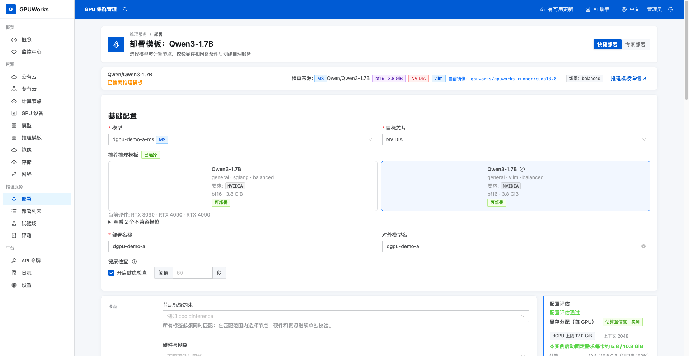
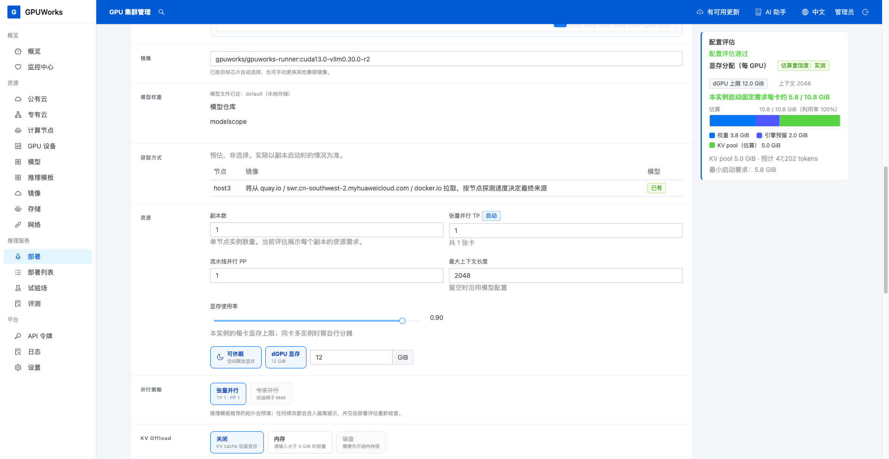
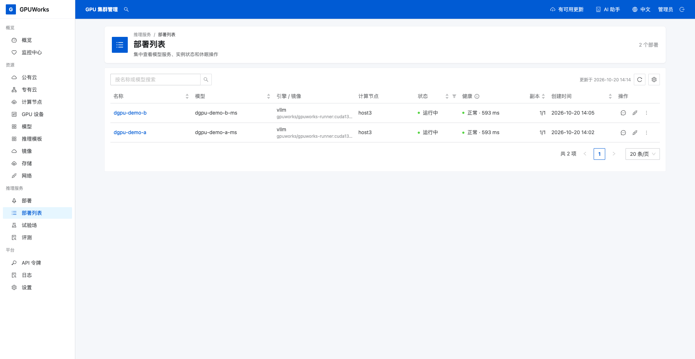
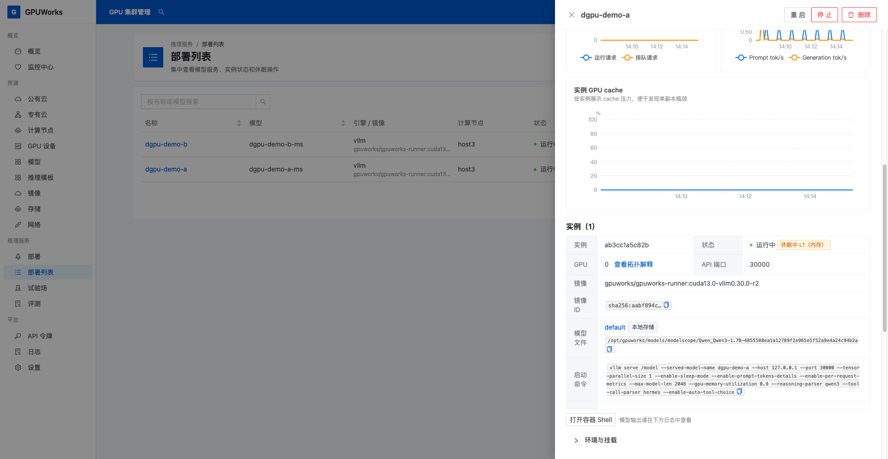

# 一张 GPU 跑两个模型

**适用场景**：在一张 NVIDIA GPU 上同时运行两个小型对话模型，分别设置 dGPU 显存上限，并让其中一个休眠、唤醒。

完成后，两个单副本部署共用同一卡且可分别调用；A 休眠时 B 仍能回答，A 唤醒后恢复回答。

## 开始之前

| 你需要 | 检查方法 |
|---|---|
| 可用的 GPUWorks 控制台和有相应权限的账号 | 能查看节点、创建和删除部署、使用或创建推理 API 令牌 |
| 获准用于实验、空闲容量足够的 NVIDIA GPU | 示例使用 RTX 4090（48 GiB）；节点已接入且在线，卡详情显示 **dGPU 可用**，检查位置见下一步。缺少节点时可参阅[接入计算节点](../how-to/connect-nodes.md)；其他型号需先确认与模板兼容 |
| 两个小型对话模型及对应的 vLLM 模板 | 使用 ModelScope 的 `Qwen/Qwen3-1.7B` 和 `Qwen/Qwen3-4B`，均选择 NVIDIA 通用 BF16 vLLM 模板；模板镜像为 CUDA 13.0，节点驱动需 ≥ 580 |
| 模型文件和镜像 | 目标节点已有，或能下载、同步；方法见[下载和同步模型](../how-to/download-and-sync-models.md)，离线环境见[离线部署](../how-to/deploy-offline.md) |
| 足够的主机内存 | L1 休眠需容纳模型 A 的权重 |
| 能访问网关的客户端终端 | 安装 `curl`，使用 Bash；无需登录 GPU 节点或切换工作目录 |

下文的 12 GiB、16 GiB 额度已在上述 RTX 4090（48 GiB）环境验证。其他环境仍需先评估，再以实际启动和调用结果确认能否继续。

## 1. 确认目标卡并准备模型

1. 打开 **GPU 设备** 中的目标卡详情，记下所属节点和 GPU 序号，确认 **基本信息 → dGPU** 显示 **dGPU 可用**。
2. 查看 **占用实例** 和显存，确认容量足够运行两个新部署。
3. 打开 **部署列表**，确认部署名称和对外模型名 `dgpu-demo-a`、`dgpu-demo-b` 未被使用。

若目标 GPU 被自己不再需要的实验部署占用，在 **部署列表** 打开对应部署，点击 **停止** 并确认，等待实例移除、GPU 释放；保留模型与镜像。只操作自己的实验部署，不处理其他业务。

dGPU 可用表示能申请带额度的实例；两个模型是否放得下，仍需分别评估并启动。

### 注册并下载两个模型

按下表准备 A、B，下载到刚才记录的节点。目标节点上已下载的对应模型可以直接复用。

| 字段 | 模型 A | 模型 B |
|---|---|---|
| **来源** | **ModelScope** | **ModelScope** |
| **来源 ID** | `Qwen/Qwen3-1.7B` | `Qwen/Qwen3-4B` |
| **名称** | `dgpu-demo-a-ms` | `dgpu-demo-b-ms` |

1. 打开 **模型 → 注册模型**，按表格注册尚未登记的模型，**版本指定**留空，点击 **确认注册**。
2. 对未下载到目标节点的模型点击 **下载到…**，**存储**选择目标节点的本地存储（仅有一个可写本地存储时自动选定）；**计算节点**选择刚才记录的节点，点击 **下载**。
3. 点击模型名称打开详情，在 **模型文件** 中等待目标节点上的两份副本均显示 **可用**，再部署。

`dgpu-demo-a-ms`、`dgpu-demo-b-ms` 是本文的示例登记名称；已有同一来源 ID 的模型时，选择自己的对应登记项。下文部署名称和对外模型名使用 `dgpu-demo-a`、`dgpu-demo-b`。

## 2. 配置并启动模型 A

1. 打开 **部署 → 快捷部署**，在 **基础配置** 选择模型 `dgpu-demo-a-ms`、**目标芯片 NVIDIA**；在 **推荐推理模板** 选择 **Qwen3-1.7B**、**general · vllm · balanced** 档位，核对 **BF16** 权重标签。
   出现 **使用已登记的模型？** 弹窗时，选择带 **MS** 标记的 `dgpu-demo-a-ms`，点击 **使用此模型并部署**。
2. 核对模型来源 ID 为 `Qwen/Qwen3-1.7B`、镜像为 `gpuworks/gpuworks-runner:cuda13.0-vllm0.30.0-r4`，按下表填写，保留模板镜像和启动方式。

| 字段或操作 | 模型 A | 模型 B（下一步填写） |
|---|---|---|
| **模型** | `dgpu-demo-a-ms`（`Qwen/Qwen3-1.7B`） | `dgpu-demo-b-ms`（`Qwen/Qwen3-4B`） |
| **推理引擎 / 目标芯片** | vLLM / NVIDIA | vLLM / NVIDIA |
| **部署名称** | `dgpu-demo-a` | `dgpu-demo-b` |
| **对外模型名** | `dgpu-demo-a` | `dgpu-demo-b` |
| **节点** | **单机 → 手动指定**，选择第 1 节记录的节点 | 同一节点 |
| **选择节点与 GPU** | 只选第 1 节记录的 GPU 序号 | 同一个 GPU 序号 |
| **张量并行 TP / 流水线并行 PP** | `1 / 1` | `1 / 1` |
| **副本数** | `1` | `1` |
| **最大上下文长度** | `2048` | `2048` |
| **显存使用率** | `0.9` | `0.9` |
| **可休眠** | 开启 | 开启 |
| **dGPU 显存** | 开启，先填 `12` GiB，再评估 | 开启，先填 `16` GiB，再评估 |



*模型 A：选择 MS 来源的登记模型与 vLLM 档位，部署名称和对外模型名都填写 `dgpu-demo-a`。*

3. 开启 **可休眠**（卡片呈蓝色）和 **dGPU 显存**，将默认 `16` 改为 A 的额度 `12` GiB。**显存使用率** `0.9` 按此额度计算。
4. 等待右侧重新评估，确认节点、GPU 正确，无资源或配置错误，额度能容纳权重、引擎开销和最大上下文所需的 KV cache（对话上下文缓存）。



*模型 A：开启可休眠，设置 12 GiB 显存额度与 2048 上下文。右侧为配置评估，仍需部署和调用验证。*

5. 评估通过后点击 **部署**，在 **部署列表** 打开 `dgpu-demo-a`。等待实例变为 **运行中**，记录部署 ID、节点、GPU 序号和最终额度。

**dGPU 显存**是单实例的显存上限。额度之外还有运行开销，不能只看额度之和；需检查页面评估，详见[dGPU 原理](../explanation/dgpu.md)。

## 3. 在同一张卡上启动模型 B

1. 保持 A 运行，重新打开 **部署 → 快捷部署**，按第 2 节表格 B 列选择模型和目标芯片。在 **推荐推理模板** 选择 **Qwen3-4B**，档位及 **BF16** 权重标签与 A 一致。
2. 核对模型为 `dgpu-demo-b-ms`、来源 ID 为 `Qwen/Qwen3-4B`，镜像与 A 一致。模型确认弹窗的操作与 A 相同，选择带 **MS** 标记的 B。
3. 按第 2 节表格 B 列填写其余配置，**手动指定**与 A 相同的节点，只选同一个 GPU 序号。
4. 开启 **可休眠**和 **dGPU 显存**，确认额度为 `16` GiB。A 已占用资源，需等待本次评估，不能沿用创建 A 前的空闲容量。
5. 评估通过后点击 **部署**，等 B 的实例变为 **运行中**，记录其部署 ID 和最终配置。
6. 在 A、B 的部署详情分别核对 GPU 序号；打开 **GPU 设备** 中的同一卡详情，确认 **占用实例** 同时出现 `dgpu-demo-a` 和 `dgpu-demo-b`。

A、B 必须同时运行后再验证调用，不能靠休眠 A 或其他业务腾出容量。



*两个部署均在运行且健康正常。列表只显示同一节点，还需在实例详情核对 GPU 序号均为 `0`。*

## 4. 分别调用两个模型

1. 准备已保存的完整 `gw-` 推理令牌。没有可用令牌时，打开 **API 令牌 → 推理服务令牌 → 创建推理令牌**，名称填写 `dgpu-demo`，点击 **创建**。
2. 新建令牌后，在 **请立即保存 API 令牌**弹窗点击 **复制 API 令牌**，安全保存完整值，再点击 **我已保存**；已有完整令牌可跳过。列表中的前缀不能用于调用。
3. 在可访问网关的客户端 Bash 终端执行下列命令。将示例地址替换为实际网关地址，不带末尾 `/v1`；默认同端口部署使用控制台地址。

```bash
GPUWORKS_URL='http://192.0.2.10:8800'
read -r -s -p '推理 API 令牌: ' GPUWORKS_API_KEY
printf '\n'
```

4. 调用模型 A，请求中的 `model` 与**对外模型名**保持一致。

```bash
curl -sS -w '\nHTTP %{http_code}\n' "$GPUWORKS_URL/v1/chat/completions" \
  -H "Authorization: Bearer $GPUWORKS_API_KEY" \
  -H 'Content-Type: application/json' \
  -d '{"model":"dgpu-demo-a","messages":[{"role":"user","content":"用一句话介绍你自己。"}],"max_tokens":256,"chat_template_kwargs":{"enable_thinking":false}}'
```

5. 调用模型 B。

```bash
curl -sS -w '\nHTTP %{http_code}\n' "$GPUWORKS_URL/v1/chat/completions" \
  -H "Authorization: Bearer $GPUWORKS_API_KEY" \
  -H 'Content-Type: application/json' \
  -d '{"model":"dgpu-demo-b","messages":[{"role":"user","content":"用一句话介绍你自己。"}],"max_tokens":256,"chat_template_kwargs":{"enable_thinking":false}}'
```

**完成依据**：两次请求均返回 `HTTP 200`，`choices[0].message.content` 中有回答，内容不要求相同。使用不同的对外模型名，分别确认两个服务。

示例关闭 Qwen3 思考模式，最多输出 256 个 token，便于检查简短回答。保留终端，休眠、唤醒时还要重复这两条命令。

调用成功后再做休眠实验。

## 5. 休眠 A，确认 B 仍能回答

1. 打开 **GPU 设备** 中的目标卡详情，记下显存用量，供休眠后比较。
2. 打开 **部署列表 → dgpu-demo-a** 详情，点击 **休眠（内存/L1）**；在弹框选择 **先完成在途请求（推荐）**，点击 **休眠**。
3. 等待实例面板的 **正在进入休眠 · L1** 变为 **休眠中 L1（内存）**，再到目标卡详情确认显存下降；休眠有显存残留，不要求归零。
4. 在原终端重跑第 4 节 A 的命令，确认 `HTTP 503` 且错误说明模型休眠；再调用 B，确认仍返回 `HTTP 200` 和回答。



*以橙色的 **休眠中 L1（内存）** 标签确认休眠完成；旁边的 **运行中** 不代表此时仍可处理推理请求。*

`503` 可能早于休眠完成，需同时检查休眠标签和调用结果。

## 6. 唤醒 A，再验证两个模型

1. 在 **dgpu-demo-a** 的部署详情点击 **唤醒**。
2. 等待实例面板的 **正在唤醒** 标签消失。仅有 **运行中** 不能判断唤醒完成，还需验证调用。
3. 在原终端重跑第 4 节 A、B 的命令，确认均返回 `HTTP 200` 和回答，且仍使用同一卡。

**最终结果**：A、B 共用同一卡且分别可调用；A 休眠完成后只有 A 被网关拒绝，B 继续回答；A 唤醒完成后两者恢复调用。休眠级别、失败处理和其他部署形态见[操作 sleep / wake](../how-to/sleep-wake.md)。
