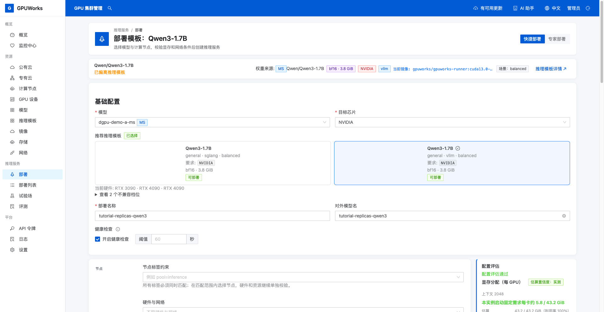
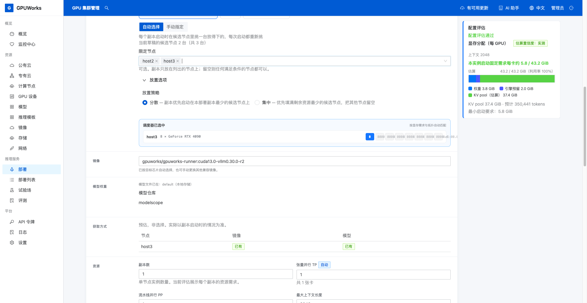
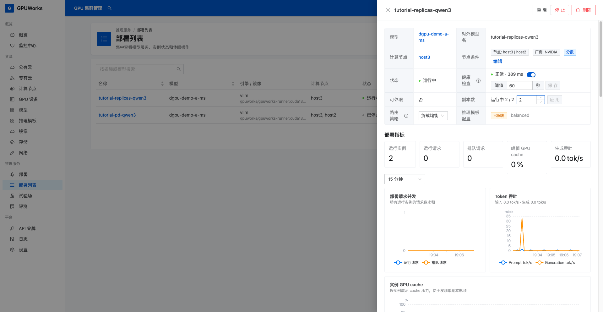
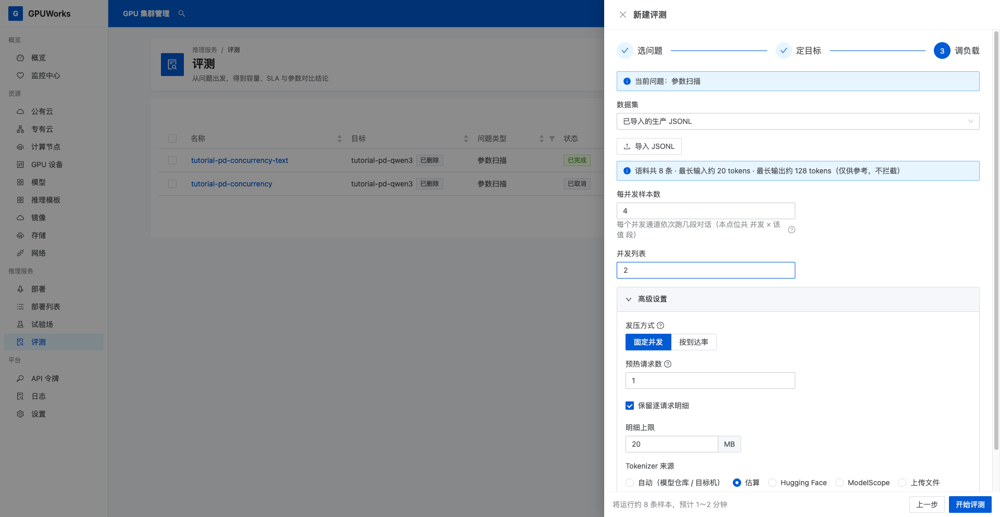
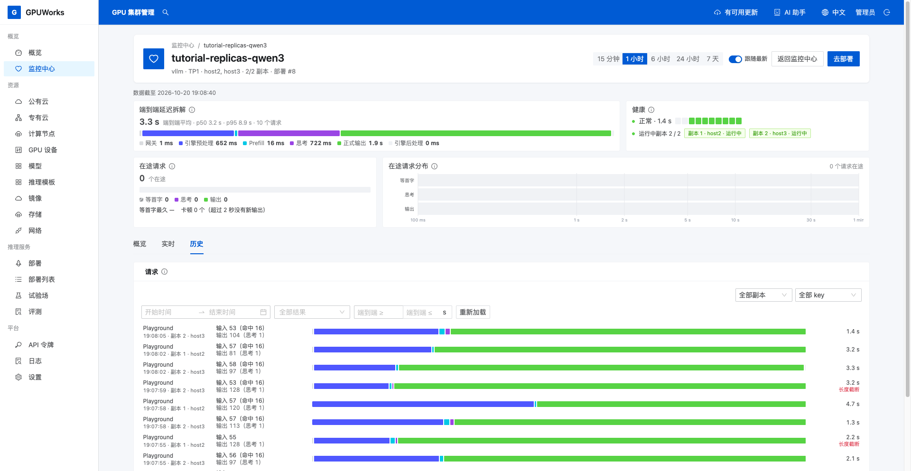
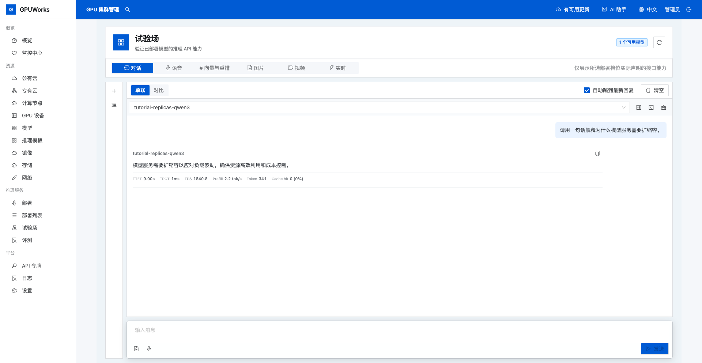

# 把一个模型服务从一副本扩到两副本

**适用场景**：一个模型已经能在单张 GPU 上运行，希望增加一个独立副本分担请求，并在负载降低后缩回一副本。

**目标**：创建 `tutorial-replicas-qwen3`，从一副本扩到两副本，确认两台节点都收到成功请求，再缩回一副本并完成一次对话。

## 开始之前

| 你需要 | 本文使用的配置与检查位置 |
|---|---|
| 控制台权限 | 能查看节点、创建和修改部署、创建评测、使用试验场 |
| 两台可用节点 | `host2`、`host3` 均在线且允许调度，各有一张空闲的 RTX 4090（48 GiB）；在 **GPU 设备** 中检查占用实例 |
| 模型 | 已登记 ModelScope 的 `Qwen/Qwen3-1.7B`，两台节点的模型文件均为 **可用**；本文的示例登记名称为 `dgpu-demo-a-ms` |
| 推理模板与镜像 | 档位 `bf16-vllm-nvidia-general`，镜像 `gpuworks/gpuworks-runner:cuda13.0-vllm0.30.0-r2`；两台节点已取得镜像 |
| 软件环境 | 本文实测 Server、Agent `dca20f6d`，运行时 runveil，NVIDIA 驱动 `610.57.04` |
| 节点与磁盘 | 两台节点可向 Server 提供服务，运行时所在文件系统有足够空间容纳镜像解包文件和运行日志 |
| 练习数据 | 下载 [benchmark-prompts.jsonl](../assets/examples/benchmark-prompts.jsonl) 到操作浏览器的电脑；文件包含 8 条合成练习样本，每条带 `/no_think`，输出上限为 `128` token |

`host2`、`host3` 和 `dgpu-demo-a-ms` 是本文截图中的示例名称。操作时选自己的对应节点，并按来源 ID `Qwen/Qwen3-1.7B` 找到自己登记的模型；登记名称可以不同。模型尚未准备好时，按[下载和同步模型](../how-to/download-and-sync-models.md)准备两台节点的文件。

若仍运行占用这两张 GPU 的实验部署，先在其部署详情点击 **停止**，等 GPU 释放后再继续；记下这些部署，实验结束后按需恢复。

本文选择 **单机**，表示每个副本各自在一台节点上完成推理。扩成两个副本后，两台节点各运行一份完整模型。

## 1. 创建一副本服务

1. 打开 **部署 → 快捷部署**，在 **基础配置** 选择自己登记的 `Qwen/Qwen3-1.7B`（本文为 `dgpu-demo-a-ms`），**目标芯片**选择 **NVIDIA**。
2. 在 **推荐推理模板** 中选择 **Qwen3-1.7B** 的 **general · vllm · balanced** 档位，核对 **bf16** 标签。出现 **使用已登记的模型？** 弹窗时，选择同一模型的 **MS** 登记项，点击 **使用此模型并部署**。
3. 核对来源 ID、档位和镜像与准备表一致，**部署名称**和**对外模型名**均填写 `tutorial-replicas-qwen3`。

4. 在 **节点** 区域选择 **单机 → 自动选择**，在 **限定节点** 中同时选择 `host2` 和 `host3`。展开 **放置选项**，将**放置策略**保持为 **分散**。
5. 按表格填写资源参数，保留健康检查开启。

| 字段 | 值 |
|---|---|
| **副本数** | `1` |
| **张量并行 TP** | `1` |
| **流水线并行 PP** | `1` |
| **最大上下文长度** | `2048` |
| **显存使用率** | `0.90` |
| **可休眠** | 关闭 |
| **dGPU 显存** | 不启用 |
| **KV Offload** | 关闭 |

**限定节点**确保副本只在这两台中选择；**分散**优先使用本部署副本较少的候选节点。GPU 由调度器自动选择，核对右侧预览为单副本使用一张卡。

若刚停止其他部署并释放 GPU，创建表单仍提示没有可用 GPU，重新进入 **部署 → 快捷部署**，按以上配置重新填写并检查候选节点。

6. 等待右侧显示 **配置评估通过**，点击 **部署**。
7. 在 **部署列表** 打开 `tutorial-replicas-qwen3`，等待**副本数**显示 **运行中 1 / 1**、健康检查正常。记录第一个实例的节点和 GPU。
8. 打开 **试验场 → 对话**，点击 **新对话**，选择 `tutorial-replicas-qwen3`，发送“请用一句话解释模型副本。”，确认得到正常回答。

第一个副本可能落在任意一台候选节点上，不要求它固定为 `host2`。若副本在等待节点，检查部署详情的等待原因和**查看候选节点**；启动失败时打开该实例的 **日志**，处理显存、模型文件或磁盘问题后再重试。

## 2. 扩容到两副本

1. 回到 **部署列表 → tutorial-replicas-qwen3**。
2. 在 **副本数**右侧的数字框中，将 `1` 改为 `2`，点击 **应用**。
3. 等待**副本数**变为 **运行中 2 / 2**。展开两个实例，核对一个在 `host2`、另一个在 `host3`，各使用一张 GPU，状态均为 **运行中**。
4. 检查此时出现的**路由策略**，保持 **负载均衡**。

点击 **应用**只更新期望副本数，新增实例还要经过启动和健康检查。看到期望值 `2` 不代表扩容完成；只有两个实例都已运行，才能继续验证请求分布。

如果仍为 **运行中 1 / 2**，先检查第二台节点是否在线、允许调度且 GPU 空闲，并查看新实例的日志。等待模型或镜像准备完成后再判断结果。

## 3. 发出并发请求并核对两个副本

1. 打开 **推理服务 → 评测**，点击 **新建评测**，在 **选问题** 中选择 **参数扫描**。
2. 在 **定目标** 中填写：

| 字段 | 值 |
|---|---|
| **评测名称** | `tutorial-replicas-distribution` |
| **目标** | **托管实例** |
| **推理服务** | `tutorial-replicas-qwen3` |
| **发压点** | **Server** |

**Server**让请求经过该服务的网关和负载均衡。若改为计算节点，测量的是该节点上的实例，无法用这次评测核对两个副本的分流。

3. 点击 **下一步**，在 **数据集** 中选择 **已导入的生产 JSONL**，点击 **导入 JSONL**，选择刚下载的 `benchmark-prompts.jsonl`，等待提示 **已导入 8 条样本**。选项名称包含“生产”，本文导入的是合成练习数据。
4. 填写 **每并发样本数** `4`、**并发列表** `2`；展开 **高级设置**，选择 **固定并发**，**预热请求数**设为 `1`，勾选 **保留逐请求明细**，**Tokenizer 来源**选择 **估算**。

导入样本按文件原文发送，无需 Tokenizer 生成定长输入；不填写 **输入长度 ISL**或**输出长度 OSL**，也不启用固定输出长度。文件中每条的 `output_tokens: 128` 是输出上限，回复可以提前结束。这里用带 `/no_think` 的样本产生正式答案，避免把只有思考输出、但缺少有效计时的请求用于评测判断。

5. 点击 **开始评测**，等待评测完成，核对本次只有并发 `2` 一个点位、正式请求数为 `8`、成功率为 `100%`。预热请求不计入点位结果，但可能出现在服务的请求历史中。
6. 打开 **监控中心 → tutorial-replicas-qwen3 → 历史**，选择包含本次评测的时间范围，找到这一轮成功请求。
7. 分别打开落在不同副本上的请求，核对**副本**字段：至少一条由 `host2` 的实例处理，至少一条由 `host3` 的实例处理，两条的**状态**均为 `200`。

本次评测的 `8` 个正式请求全部成功，两个副本均参与服务。另有 `1` 个预热请求由 `host3` 处理，不计入下表。

| 节点 | 正式成功请求数 | 已核对的请求详情 |
|---|---:|---|
| `host2` | `3` | `r18305`：状态 `200`，结束原因 `stop`，总计约 `3.2 s` |
| `host3` | `5` | `r18318`：状态 `200`，结束原因 `stop`，总计约 `1.4 s` |

自己的请求 ID、分布和耗时会不同。图中的 **长度截断**表示某条回复达到了设置的输出上限；打开详情核对其 HTTP 状态，不把所有请求的结束原因都要求为 `stop`。

负载均衡优先把请求发给当前负载较轻的副本，请求数不要求各占一半。本文核对的是两个副本都实际参与服务；两副本是否提高吞吐，需要保持负载和其他配置相同，分别评测一副本、两副本后比较。运行评测和读取报告的操作见[运行一次性能评测并读懂报告](benchmark-concurrency.md)。

如果历史里只看到一个实例，先检查是否选了 **Server**、两副本是否都运行且未休眠、**路由策略**是否为 **负载均衡**，再确认时间范围覆盖这一轮请求；不要仅凭实例已启动判定分流成功。

## 4. 缩回一副本并再次调用

1. 等本轮评测结束，回到 **部署列表 → tutorial-replicas-qwen3**。
2. 将 **副本数**从 `2` 改为 `1`，点击 **应用**。
3. 等待**副本数**显示 **运行中 1 / 1**。检查保留下来的实例为 **运行中**，另一个实例不再运行；再到 **GPU 设备** 确认它占用的 GPU 已释放。
4. 打开 **试验场 → 对话**，点击 **新对话**，仍选择 `tutorial-replicas-qwen3`，发送“请用一句话解释为什么模型服务需要扩缩容。”。
5. 等待正常回答完成，在该服务的请求历史中确认这次请求由保留的实例处理，状态为 `200`。

本次已完成 `1 → 2 → 1` 的扩缩容与调用验证：缩容后保留 `host3` 的实例，`host2` 的 GPU `0` 已释放。随后请求 `r18544` 仍由同一模型名正常应答，落在保留的实例上，状态为 `200`、结束原因为 `stop`。

缩容时平台会选择撤下的副本，让它处理完已有请求后停止；不指定必须保留哪台节点。若需要明确撤下某一个副本，可在该实例的操作区使用 **移除此副本**，它同样会减少部署的副本数。

**完成条件**：一副本时能调用，扩容后两个实例分处两台节点且都处理过成功请求，缩容后只保留一个运行实例、另一张 GPU 已释放，同一个对外模型名仍能正常回答。

## 5. 清理实验资源

1. 不再需要实验部署时，打开 **部署列表 → tutorial-replicas-qwen3**，点击 **删除**并确认，使用普通删除。
2. 等待部署从列表移除，再检查两张 GPU 都不再被该部署占用。已登记模型、模型文件和镜像保留，供后续复用。
3. 在 **评测**列表找到 `tutorial-replicas-distribution`，按需先导出报告，再点击 **删除**；删除后该次点位和逐请求明细会清除。
4. 如果开始实验前停止了其他实验部署，在相应部署详情点击 **启动**，等待其原有副本恢复并验证调用。
