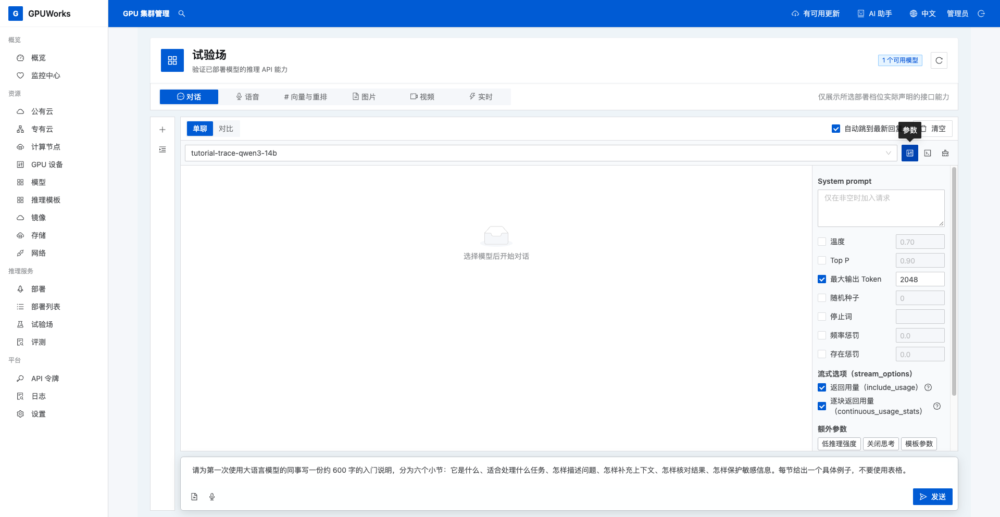
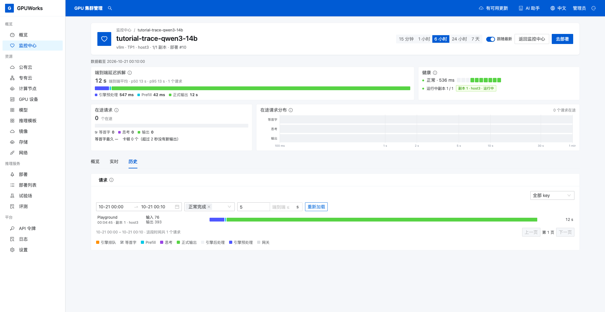
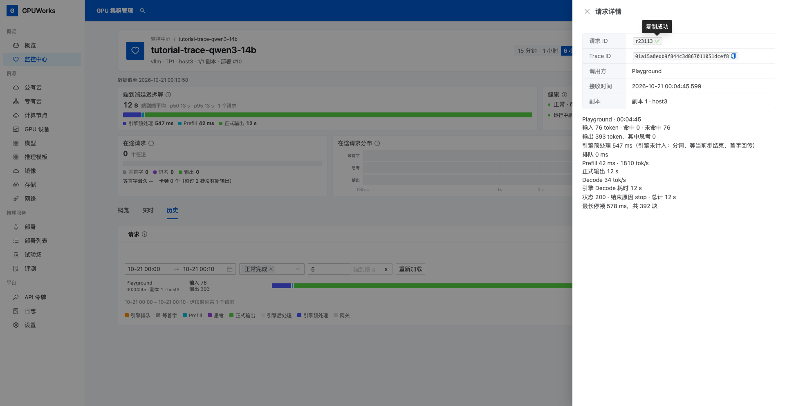
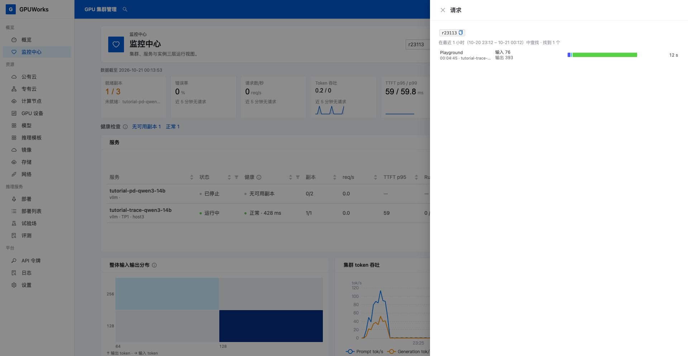

# 定位一次回答慢的请求

模型能正常回答，但回答开始得慢，或整段输出耗时较长时，可以从请求历史查看时间花在哪个阶段。本教程从一次试验场调用出发，找到对应请求、读懂耗时，再用请求 ID 找回同一条记录。

## 开始之前

- 有打开 **试验场**和**监控中心**的权限。
- 有一个可在试验场正常流式回答的对话服务，并能查看它的历史请求。
- 引擎提供逐请求耗时时，可以进一步区分排队、Prefill 等阶段；未提供时，仍可查看整体等待和输出耗时。

本文使用普通单机、单副本服务 `tutorial-trace-qwen3-14b`：模型为 `Qwen/Qwen3-14B` BF16，引擎为 vLLM `0.30.0`，TP 为 `1`，已关闭思考输出并开启逐请求耗时。跟随操作时选择自己的服务，无需完成其他教程；自己的回答和耗时无需与示例一致。

## 1. 发起一条容易辨认的请求

1. 打开 **试验场 → 对话**，点击 **新对话**（加号），选择自己的服务；本例选择 `tutorial-trace-qwen3-14b`。
2. 点击模型选择框右侧的 **参数**，勾选 **最大输出 Token**并填写 `2048`，保留 **流式选项 → 返回用量**开启。输出上限不代表模型一定生成这么多 token。
3. 输入以下问题，记下当前时间，点击 **发送**。

   ```text
   请为第一次使用大语言模型的同事写一份约 600 字的入门说明，分为六个小节：它是什么、适合处理什么任务、怎样描述问题、怎样补充上下文、怎样核对结果、怎样保护敏感信息。每节给出一个具体例子，不要使用表格。
   ```



4. 等待回答结束，确认没有请求错误，留意是等待回答开始较久，还是开始后持续输出较久。本例请求正常完成，后续通过请求详情判断各阶段耗时。

如果请求报错或被手动停止，先处理问题并重新调用。本教程分析正常完成的请求。

## 2. 在服务历史中找到这次调用

1. 打开 **监控中心**，在服务列表点击刚才选择的服务。
2. 在页面顶部选择 **6 小时**，切换到 **历史**。
3. 在 **开始时间**、**结束时间**中填写覆盖刚才调用的起止时间，每项按 Enter 确认。格式为 `MM-DD HH:mm`；本例使用 `10-21 00:00` 至 `10-21 00:10`。
4. 结果选择 **正常完成**，在 **端到端 ≥**中填写 `5`，单位为秒，点击 **重新加载**。本例请求约 `12.2 s`，会落在这个范围内。



5. 按调用时间和 **Playground**调用方找到请求，点击该行打开 **请求详情**。本例接收时间为 `10-21 00:04:45`。

如果没有结果，先清空端到端下限并检查时间范围，自己的请求可能不到 5 秒。后续分析使用这条请求的耗时，页面顶部的平均值代表所选时段的整体情况。

## 3. 读出时间主要花在哪里

1. 先核对页面顶部的服务名，再在详情顶部核对 **接收时间**、**调用方**和**副本**，点击 **请求 ID**旁的复制按钮并保存。本例为 `r23113`。
2. 在详情底部确认 **状态 200**、**结束原因 stop**，查看 **总计**和各阶段的时长。
3. 比较各阶段，找出最长的一段。下表使用本次请求记录的精确值；截图中的正式输出和总计均取整显示为 `12 s`。

| 阶段 | 本例记录 | 含义 |
|---|---|---|
| 引擎预处理 | `547 ms` | 首 token 前未归入引擎排队和提示计算的时间 |
| Prefill | `42 ms` | 引擎处理输入提示的时间 |
| 正式输出 | `11595 ms` | 从首个正文 token 到最后一块文字的时间 |



本次输入 `76` 个 token，输出 `393` 个 token，思考 token 为 `0`。从网关收到请求开始，首个正文在 `547 + 42 = 589 ms`，即约 `0.59 s` 后到达；整条请求耗时 `12184 ms`，即约 `12.18 s`。本例没有思考输出，首个生成 token 就是首个正文 token。

**这次请求主要耗时在正文输出**：正式输出约 `11.60 s`，占总耗时约 `95.2%`。首字已经在约 `0.59 s` 时到达，因此不能把整段 `12.18 s` 都解释为等待回答开始。操作时根据自己请求中最长的阶段形成结论。

如果有 **思考**阶段，首个生成 token 与首个正文之间还包含思考时间；如果引擎没有细分排队与 Prefill，页面会显示合并的 **等首字**。按实际出现的阶段读取，不将合并等待直接归因于网络。详情中的 **引擎 Decode 耗时**用于对照，不再加到色条各阶段之和中。完整定义见[请求时间线与阶段拆分](../reference/request-timeline.md#1-记录了哪些时间点)。

## 4. 用请求 ID 找回同一条记录

1. 关闭详情，回到 **监控中心**首页。
2. 在右上角 **请求 ID / Trace ID**搜索框粘贴第 3 节保存的请求 ID，按回车。本例填写 `r23113`，操作时替换为自己的 ID。
3. 在右侧 **请求**面板点击命中的记录，核对 **请求 ID**、**部署**、**接收时间**和总耗时与刚才一致。



搜索默认查最近 1 小时。显示 **没有找到**时，点击 **扩大到最近 24 小时**；仍未找到时，核对 ID、调用时间和记录是否已保存。历史请求有保留与抽样限制，未查到不能证明请求没有发生，见[监控指南的数据来源与限制](../how-to/monitor-and-logs.md#2-看请求视图与请求分布)。

**完成条件**：能从服务历史找到自己的请求，再用请求 ID 找回同一条记录；能说明首字等待、正文输出和总耗时之间的关系，并根据实际阶段指出时间主要花在哪里。
